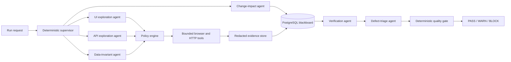

# Qualestra

> Supervised AI orchestration for software quality.

[](https://github.com/itsvsk/Qualestra/actions/workflows/ci.yml)
[](https://www.python.org/)
[](https://playwright.dev/)
[](LICENSE)
[](#project-status)

Qualestra is an evidence-first, supervised QA orchestration system. It coordinates specialized
logical agents to explore a test application through its UI and API, check business invariants,
independently replay suspicious behaviour, produce reproducible defects, and make a deterministic
`PASS`, `WARN`, or `BLOCK` release recommendation.

AI can propose testing hypotheses, but it cannot grant itself permissions, execute arbitrary code,
choose untrusted URLs, inject selectors, access credentials, or decide whether a release passes.
Every action crosses a deterministic policy boundary and every release decision is calculated from
persisted, typed evidence.

This repository is the public engineering snapshot of Qualestra. It contains the orchestration
engine, logical agents, contracts, policy controls, dashboard, synthetic test product, tests, and
deployment examples. Private development environments, generated evidence, credentials, internal
progress records, and organization-specific test configurations are not included.

Qualestra is an independent personal project by Vishal Appu Daniel. It is not affiliated with,
sponsored by, or developed on behalf of any employer or other organization.

## Why Qualestra exists

Most automated testing workflows are either:

- scripted suites that only exercise paths someone remembered to write;
- exploratory tools that generate useful ideas but weak evidence;
- autonomous agents with broad permissions and difficult-to-audit decisions; or
- disconnected test, defect, reporting, and release-gate systems.

Qualestra combines exploratory breadth with deterministic control. It treats AI as a bounded
reasoning component inside a larger QA system—not as the system of record.

## What it does

- Plans test charters from configured product areas and change-impact information.
- Explores UI flows in Chromium, Firefox, and WebKit.
- Explores allowlisted API operations and validates response schemas.
- Evaluates portable business invariants across API and product state.
- Replays anomalies independently before promoting them to verified defects.
- Minimizes reproduction paths and classifies defect severity and confidence.
- Stores runs, tasks, transitions, observations, defects, and release decisions durably.
- Generates deterministic JSON, Markdown, and HTML reports from committed run facts.
- Delivers reports through an approval-gated durable outbox.
- Supports offline-safe GitHub Issues, Jira, Slack, filesystem, and no-op connector boundaries.
- Provides an operator dashboard for runs, evidence, comparisons, gates, reports, and deliveries.
- Runs fully offline with a deterministic mock model by default.

## How the orchestration works



The six agents are logical responsibilities inside one modular `qa-worker` deployment:

| Agent | Responsibility | Important boundary |
| --- | --- | --- |
| Change impact | Prioritizes affected product areas and creates test charters | Cannot execute product actions |
| UI exploration | Observes and explores browser states | Uses only policy-authorized candidates |
| API exploration | Exercises safe allowlisted API operations | Cannot invent endpoints or unsafe payloads |
| Data invariant | Checks configured business and consistency rules | Runs typed rules, never arbitrary SQL |
| Verification | Resets, replays, and scores suspicious behaviour | Must reproduce before defect promotion |
| Defect triage | Deduplicates and prepares developer-ready defects | Cannot alter evidence or the release gate |

Agents cannot call peers, create more agents, expand their capabilities, or choose the release
outcome. The supervisor owns the task graph, budgets, retries, cancellation, leases, and terminal
state.

## Quick start

### Requirements

- Docker Desktop or another Docker Engine with Compose
- About 8 GB of free memory recommended for the full browser-enabled stack
- Internet access during the first image build

Clone and start the bundled demonstration:

```bash
git clone git@github.com:itsvsk/Qualestra.git
cd Qualestra
cp .env.example .env
docker compose up --build --detach --wait
```

The first worker image build installs Chromium, Firefox, and WebKit. Later builds use the Docker
cache.

Open:

- Qualestra control room: <http://localhost:3000>
- Atlas synthetic test application: <http://localhost:5173>
- Control API documentation: <http://localhost:8000/docs>

The default Atlas profile is healthy. Start a run from the control room, or submit one through the
API:

```bash
curl -X POST http://localhost:8000/v1/runs \
  -H 'content-type: application/json' \
  -d '{
    "target_id": "atlas-local",
    "trigger": "manual",
    "seed": 41021,
    "personas": ["owner", "viewer"],
    "browsers": ["chromium", "firefox", "webkit"],
    "browser_settings": {
      "viewport_width": 1440,
      "viewport_height": 900,
      "locale": "en-US",
      "timezone_id": "UTC",
      "color_scheme": "light",
      "reduced_motion": "no-preference"
    }
  }'
```

Run the repeatable acceptance scenarios:

```bash
.venv/bin/python scripts/live_smoke.py --expected passed
ATLAS_FAULT_PROFILE=all docker compose up --detach --wait atlas-api
.venv/bin/python scripts/live_smoke.py --expected blocked
ATLAS_FAULT_PROFILE=fixed docker compose up --detach --wait atlas-api
```

Stop the local system:

```bash
docker compose down
```

## Using Qualestra with another project

Qualestra describes a project with three version-controlled YAML documents:

1. an application definition containing trusted UI/API origins;
2. personas containing authentication references and roles; and
3. executable business invariants.

Generate and validate a safe starter project:

```bash
uv run qualestra init qualestra-project
uv run qualestra validate qualestra-project/applications/example.yaml
uv run qualestra doctor qualestra-project
```

Persona credentials are always environment-variable references such as `env:TEST_USER_PASSWORD`.
Credential values are resolved only at the browser or HTTP transport boundary and are not included
in prompts, reports, fixtures, or project configuration.

Supported project authentication modes are:

- no authentication;
- browser form login;
- bearer token;
- API-token header; and
- pre-issued OIDC-style test token injection.

Portable invariants support allowlisted `GET`, `POST`, `PUT`, and `PATCH` requests, expected status
codes, latency limits, and bounded typed JSON assertions. Absolute URLs, path traversal, dynamic
code, credential-like JSON paths, and destructive `DELETE` operations are rejected.

See [Connecting another project](docs/project-adapters.md) and the
[Acme Tasks example](config/applications/acme-tasks.yaml).

## Models and offline operation

`MockLLMClient` is the default, so the repository and test suite work without an API key or network
model call. Mock mode is deterministic and suitable for development, CI, demonstrations, and policy
testing.

The optional live adapter uses the OpenAI Responses API with typed structured outputs. No model name
is hard-coded: set `LLM_PROVIDER` and `LLM_MODEL` in the worker environment. A model failure falls
back to deterministic heuristic ranking; it does not bypass policy or the release gate.

## Reports, tickets, and alerts

Terminal runs can produce immutable JSON, Markdown, and HTML reports. Reports are rendered only from
persisted run facts and typed contracts, with bounded output and redaction.

All external delivery uses a durable outbox:

1. an operator selects a server-configured destination ID;
2. Qualestra creates a dry-run or approval-pending delivery;
3. the delivery orchestrator owns retries and idempotency;
4. a connector receives a bounded, redacted payload; and
5. attempt history and safe external references are persisted.

Providers are disabled by default. GitHub, Jira, and Slack endpoints, projects, channels, and
credential environment names live only in trusted server configuration. See
[Provider integrations](docs/provider-integrations.md).

## Repository map

```text
apps/                 Worker host, control API, and React dashboard
atlas/                Synthetic multi-tenant application with seeded defects
config/               Static agents, policies, gates, and safe project examples
contracts/            Versioned JSON contracts for agent and reporting boundaries
docs/                 Architecture, threat model, adapters, delivery, and runbooks
sentinelqa/            Python engine and compatibility namespace
  agents/             Six logical QA agent implementations
  orchestration/      Supervisor, scheduler, registry, runtime, and task graph
  policy/             Capabilities, budgets, redaction, and authorization
  execution/          Browser, HTTP, persona, locator, and schema tooling
  reporting/          Deterministic reports, evidence, and defect handoff
  delivery/           Durable outbox and bounded provider connectors
tests/                Unit, contract, integration, benchmark, and end-to-end tests
```

The Python import namespace and some environment/contract identifiers retain the original
`sentinelqa` name in version `0.1.x` for compatibility with persisted runs and deployment
configurations. New public commands and product documentation use `qualestra`.

## Development

Use Python 3.12+, [`uv`](https://docs.astral.sh/uv/), Node.js 22+, and pnpm:

```bash
make install
make check
make release-check
pnpm --filter @sentinelqa/dashboard lint
pnpm --filter @sentinelqa/dashboard test
pnpm --filter @sentinelqa/dashboard build
```

The complete validation suite includes formatting, linting, strict typing, unit/contract/integration
tests, dashboard tests, production builds, Compose validation, a secret scan, and a live supervised
orchestration smoke run.

## Safety principles

- Run only against explicitly allowlisted test environments.
- Keep credentials in environment variables or a secret manager.
- Do not configure destructive exploration against production.
- Keep provider integrations disabled until destinations and approvals are reviewed.
- Treat model output and application content as untrusted input.
- Preserve deterministic verification and release gates.

Read the [architecture](docs/architecture.md), [threat model](docs/threat-model.md), and
[security policy](SECURITY.md) before deployment.

## Project status

Qualestra `0.1.0` is an engineering preview and portfolio-quality release candidate. The supervised
orchestration, evidence pipeline, deterministic gate, reports, and offline connector boundaries are
implemented and tested. It is not yet presented as a hosted multi-tenant service or an unattended
production-testing replacement.

See [Project overview](docs/project-overview.md), [enhancement roadmap](docs/enhancement-roadmap.md),
and [changelog](CHANGELOG.md).

## License

Copyright 2026 Vishal Appu Daniel.

Qualestra is licensed under the [Apache License 2.0](LICENSE). Required attribution notices are in
[NOTICE](NOTICE).

## Responsible disclosure

Please do not publish suspected vulnerabilities. Follow the private reporting instructions in
[SECURITY.md](SECURITY.md).
