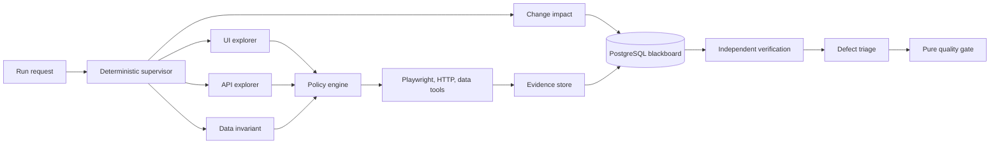

# Qualestra architecture

Qualestra is a supervised logical multi-agent system deployed as a modular monolith. One
`qa-worker` deployment embeds the control API, deterministic supervisor, and exactly six statically
registered logical agents. PostgreSQL is the authoritative blackboard; workers use an authenticated
lease/context/result boundary even inside the deployment. Agents cannot call peers, register
agents, increase capabilities, or decide a release gate.

## Boundaries

- The supervisor owns task DAGs, budgets, partitions, retries, cancellation, and deduplication;
  PostgreSQL row leases use `FOR UPDATE SKIP LOCKED` and abandoned leases recover idempotently.
- Every agent receives an immutable context projection and a capability-filtered `ToolView`.
- UI and API effects require an allowlisted origin and a policy decision against the current
  observation. Restricted actions are denied in unattended mode.
- Observations, semantic state fingerprints, transitions, and evidence are committed independently
  of model interpretation. Screenshot, DOM, and Playwright trace metadata survive process restarts.
- Verification resets and seeds Atlas, replays at least twice, and computes confidence. A finding
  below 0.70 cannot become a verified defect.
- Gate decisions are pure functions of committed metrics and versioned policy.

Compose uses PostgreSQL and Alembic migrations by default. The in-memory blackboard is limited to
fast unit and in-process acceptance tests. Atlas test controls and its seeded-fault API are private
to the Compose network; only Atlas web, the Qualestra control API, and the dashboard bind host
ports.

## AI boundary

`MockLLMClient` is the default. The live adapter uses the OpenAI Responses API with Pydantic
structured outputs and requires `LLM_MODEL`; no model name is hard-coded. Failure falls back to
heuristic ranking. Page text is untrusted and cannot supply URLs, selectors, code, SQL, secrets,
capabilities, policy changes, or gate outcomes.
