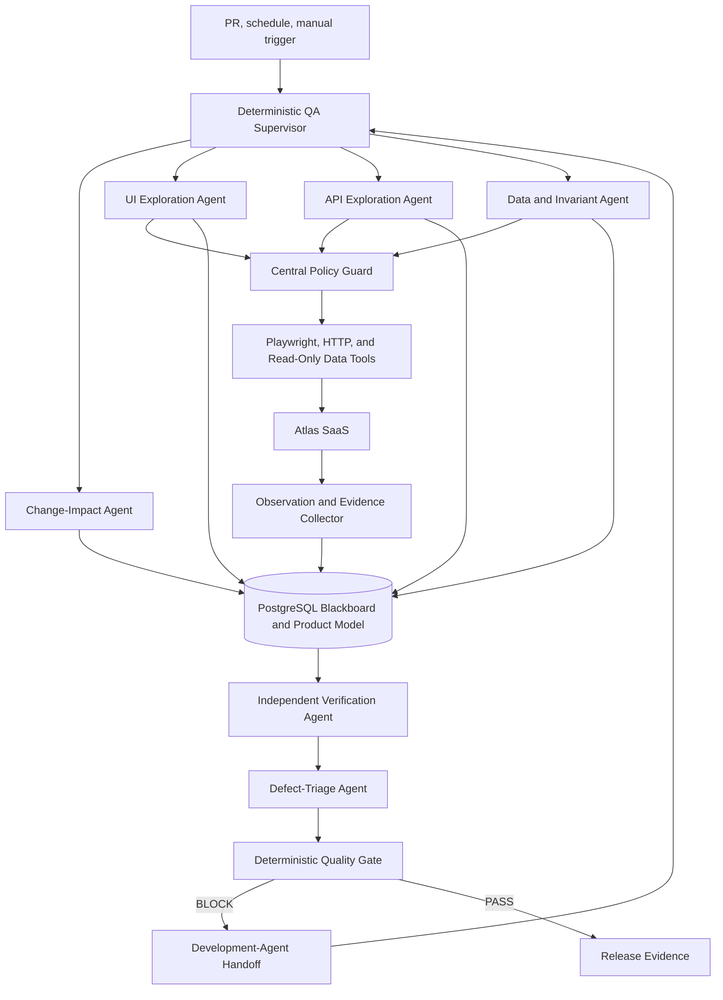

# Qualestra

## Codex-Ready End-to-End Implementation Specification

**Project type:** Portfolio-grade autonomous QA platform
**Specification version:** 1.0
**Prepared:** 18 July 2026
**Architecture:** Supervised logical multi-agent system deployed as a modular monolith
**Primary implementation:** Python 3.12, Playwright, FastAPI, PostgreSQL, OpenAI Responses API, Docker Compose
**Target duration:** 10–12 weeks part-time or 6–8 weeks full-time

> **Mission.** Build an evidence-first, supervised multi-agent QA system whose specialized agents explore an unfamiliar SaaS product, challenge it across UI/API/data layers, independently verify defects, and produce a deterministic release decision that a development agent can consume.

This document is intentionally implementation-oriented. It is the source of truth for Codex while building the repository. Where this specification says **MUST**, the requirement is required for the portfolio release. **SHOULD** means strongly recommended. **MAY** means optional or post-MVP.

---

## 1. Executive summary

Qualestra is an autonomous quality-assurance engine for complex SaaS applications. Its implementation is a **logical multi-agent system inside one modular-monolith deployment**. Specialized agents have separate responsibilities, prompts, permissions, context, budgets, and evaluation metrics, while sharing one supervised runtime, typed contracts, PostgreSQL blackboard, policy engine, and evidence store. It is not an LLM that clicks randomly, an unrestricted agent swarm, or a collection of hand-written end-to-end tests. It combines:

- a deterministic QA supervisor that scopes work and dispatches bounded agent tasks;
- specialized change-impact, UI exploration, API exploration, data/invariant, verification, and defect-triage agents;
- LLM reasoning layers that propose hypotheses and rank valid actions within agent-specific authority;
- deterministic browser and API execution;
- explicit safety policy enforcement before every action;
- dynamic, invariant, differential, metamorphic, and anomaly-based oracles;
- state and transition coverage stored as an evolving product model;
- automatic replay and evidence collection before reporting a defect; and
- deterministic quality gates that can accept or reject a build.

Agents do not converse freely or call one another directly. They exchange versioned task results through the supervisor and shared blackboard. The supervisor owns scheduling, dependency resolution, arbitration, cancellation, and total-run budgets. The deterministic quality gate remains outside the agents' authority.

The repository also contains **Atlas**, a small multi-tenant SaaS reference application with seeded, switchable defects. Atlas supplies authentication, role-based access, projects, work items, plan limits, exports, audit events, and background jobs. The engine must discover a defined subset of these defects without scenario-specific test cases.

### 1.1 Portfolio outcome

A successful demonstration shows this loop:

1. A change or scheduled run starts Qualestra.
2. The supervisor reads the run scope, user personas, product hints, and optional Git diff.
3. The change-impact agent produces a risk-weighted test charter.
4. UI, API, and data/invariant agents execute bounded tasks, in parallel when safe, while building a shared state-transition graph.
5. Oracle outputs become anomaly candidates on the blackboard.
6. The verification agent resets test data and independently replays suspicious paths.
7. The defect-triage agent produces a human-readable report and machine-readable defect envelope only from verified evidence.
8. A deterministic quality gate blocks the faulty build.
9. After a development-agent fix, the verification and neighboring-regression tasks rerun.
10. The build passes with evidence.

### 1.2 Non-goals

The MVP does not claim to prove the absence of all defects. It does not perform unrestricted security penetration testing, run against production, initiate real payments, send real external messages, or let an LLM bypass policy. It does not implement an open-ended peer-to-peer agent swarm, one container per agent, distributed consensus, or autonomous agent creation. It does not replace targeted deterministic tests for critical business rules. It does demonstrate supervised multi-agent discovery, independent verification, and release feedback with measurable limits.

---

## 2. Scope and success measures

### 2.1 Required capabilities

Qualestra MUST:

- implement logical agents through a common typed `Agent` interface within the `qa-worker` process;
- use a deterministic supervisor to create, route, prioritize, pause, retry, and cancel agent tasks;
- give every agent an explicit capability allowlist, context projection, budget, timeout, and output schema;
- exchange results only through versioned task/result contracts and the PostgreSQL blackboard;
- prevent direct peer-to-peer agent calls and dynamic agent creation in the MVP;
- execute independent UI, API, and data tasks concurrently when resource and safety policies permit;
- explore web UI controls without a pre-authored path for each scenario;
- discover and exercise APIs from OpenAPI plus browser-observed traffic;
- maintain a graph of application states and transitions;
- choose actions using a scored policy that includes coverage, risk, change relevance, novelty, uncertainty, cost, and repetition;
- use at least five oracle types: explicit, invariant, differential, metamorphic, and anomaly;
- capture screenshots, Playwright traces, console events, requests, responses, timing, and action history;
- replay every reportable anomaly in a clean session at least twice;
- produce JSON and Markdown defect reports;
- enforce environment, domain, action, data, cost, time, and rate limits;
- run in deterministic mock-LLM mode for local tests and CI;
- support targeted pull-request runs and scheduled broad exploration;
- emit a deterministic PASS, WARN, or BLOCK gate decision; and
- demonstrate an agentic development loop using file- or API-based handoff.

### 2.2 Portfolio release targets

| Measure | Release target |
|---|---:|
| Seeded defects autonomously discovered | At least 7 of 10 |
| Critical seeded defects discovered | 3 of 3 |
| Reported defects reproducible | At least 90% |
| False-positive rate on benchmark | At most 15% |
| Invalid or unexecutable selected actions | Below 2% |
| Restricted actions executed without approval | 0 |
| Duplicate defect reports | Below 10% |
| Successful evidence bundles | At least 95% of verified defects |
| Targeted PR run duration | At most 12 minutes on CI reference runner |
| Broad nightly run duration | At most 45 minutes |
| Mock-mode test suite | Fully offline and deterministic |
| Agent tasks with schema-valid results | 100% or safely rejected |
| Agent capability violations executed | 0 |
| Duplicate work caused by orchestration | Below 5% |
| Recoverable abandoned agent tasks | 100% in integration tests |

### 2.3 Definition of autonomous

A run is autonomous when the application-specific input is limited to configuration, credentials for test personas, optional high-level business invariants, and safety rules. The supervisor must be able to decompose the run into bounded agent tasks without a human assigning each path. There MUST NOT be a scripted click sequence or assertion tailored to each seeded defect. Reusable login adapters, test-data factories, reset endpoints, generic business invariants, and fixed agent capability definitions are allowed and expected.

### 2.4 Definition of multi-agent

Qualestra is multi-agent at the **logical responsibility and execution** level, not at the deployment boundary. An agent qualifies as a separate logical agent when it has:

- a stable agent type and version;
- one bounded objective and task input schema;
- an agent-specific context projection rather than the entire run history;
- an explicit tool and action capability set;
- separate time, action, request, and model budgets;
- a typed result or failure contract;
- agent-specific traces and evaluation metrics; and
- no authority to expand its own permissions or instantiate new agents.

All logical agents initially run in the same `qa-worker` container and Python process. This keeps transactions, debugging, local setup, and portfolio demonstration simple while preserving interfaces that can later move behind a durable distributed task system.

---

## 3. Reference system under test: Atlas SaaS

Atlas is included so the portfolio project is reproducible and evaluable without depending on a third-party demo site.

### 3.1 Atlas domain

Atlas is a multi-tenant work-management SaaS product.

- **Organizations:** tenant boundary and subscription owner.
- **Users:** belong to one or more organizations.
- **Roles:** owner, admin, editor, viewer.
- **Projects:** containers for work items.
- **Work items:** title, description, status, assignee, priority, labels, due date.
- **Comments:** work-item discussion.
- **Plans:** free, team, enterprise; enforced project and export limits.
- **Exports:** background CSV generation with queued, running, completed, failed states.
- **Audit events:** immutable record of sensitive operations.
- **Webhooks:** delivered only to an in-repository sink; no external network.

### 3.2 Atlas architecture

- FastAPI backend with an OpenAPI 3.x document.
- PostgreSQL database shared only through separate schemas or databases with Qualestra.
- React/Vite frontend.
- Python background worker for exports and webhook delivery.
- Mailpit or a local message sink for email-like events.
- Fault-injection middleware controlled by `ATLAS_FAULT_PROFILE` and per-fault flags.

### 3.3 Required personas

| Persona | Role | Behavioral emphasis |
|---|---|---|
| Olivia Owner | owner | billing, settings, plan limits, destructive actions |
| Arun Admin | admin | membership, projects, exports, audit records |
| Elena Editor | editor | create/update work, rapid repeat actions, refresh and recovery |
| Victor Viewer | viewer | read-only access and authorization boundaries |
| Nora New User | editor | onboarding, empty states, first-use comprehension |

### 3.4 Test-data contract

Atlas MUST expose a test-only control API when `ATLAS_TEST_MODE=true`:

```http
POST /__test/reset
POST /__test/seed
POST /__test/faults/{fault_id}/enable
POST /__test/faults/{fault_id}/disable
GET  /__test/state
```

These endpoints MUST bind only to the private Compose network, require a test control token, and be unavailable in non-test deployments.

---

## 4. System architecture



### 4.1 Architectural principles

1. **AI proposes; policy permits; deterministic tools act.**
2. **The supervisor owns coordination.** Agents do not directly invoke or privately negotiate with other agents.
3. **Agent authority is bounded.** Every agent has declared capabilities, context, budget, timeout, and output contract.
4. **Evidence precedes judgment.** Raw observations are retained independently of any agent or LLM interpretation.
5. **Verification is independent.** The agent that discovers an anomaly cannot mark it verified.
6. **Every state-changing action is auditable.**
7. **Every reportable defect is replayable.**
8. **Release blocking is deterministic.** Agents may explain or recommend, but cannot directly set the gate outcome.
9. **The engine is useful without an LLM.** Mock mode and heuristic exploration must still crawl and detect deterministic failures.
10. **The page is untrusted input.** DOM text can inform hypotheses but can never change policy, credentials, allowed tools, or system instructions.

### 4.2 Runtime services

| Service | Responsibility | MVP technology |
|---|---|---|
| `control-api` | Run creation, status, defects, evidence, model and gate APIs | FastAPI |
| `qa-worker` | Hosts the supervisor and all logical agents; executes bounded tasks with structured concurrency | Python asyncio modular monolith |
| `dashboard` | Run graph, findings, evidence and gate viewer | React/Vite |
| `postgres` | Runs, graph, artifacts metadata, findings, coverage | PostgreSQL |
| `artifact-store` | Screenshots, traces, HAR, JSON, video | Local volume; S3 adapter optional |
| `atlas-api` | Reference SaaS API | FastAPI |
| `atlas-web` | Reference SaaS UI | React/Vite |
| `atlas-worker` | Exports and webhook jobs | Python worker |
| `mailpit` | Safe local email sink | Mailpit |
| `otel-collector` | Optional telemetry collection profile | OpenTelemetry Collector |

The MVP SHOULD use a PostgreSQL-backed run and agent-task queue with row leasing to reduce infrastructure. One `qa-worker` process hosts an in-process `AgentRuntime` using `asyncio.TaskGroup` or equivalent structured concurrency. Independent read-heavy agent tasks MAY run concurrently; state-changing tasks sharing the same persona or target partition MUST be serialized. Redis or Temporal MAY replace the task queue after the first portfolio release without changing the logical agent contracts.

### 4.3 Logical agent topology

The supervisor creates tasks from a static agent registry. The MVP registry contains exactly these agent types:

| Agent | Primary input | Tools/capabilities | Required output |
|---|---|---|---|
| `change_impact` | Git diff, app profile, risk history | Repository metadata and read-only product model | Risk-weighted test charter |
| `ui_explorer` | Charter slice, persona, current graph | Observed Playwright actions through policy | Transitions, coverage, anomaly candidates |
| `api_explorer` | OpenAPI, charter slice, resource pool | Allowlisted HTTP/Schemathesis through policy | Operation coverage, sequences, anomaly candidates |
| `data_invariant` | Entities, observations, invariants | Read-only test data adapter and APIs | Invariant evaluations and cross-layer anomalies |
| `verification` | Anomaly and evidence bundle | Reset, seed, deterministic replay tools | Reproduction result, minimized path, confidence inputs |
| `defect_triage` | Verified result and evidence index | Read-only evidence and defect history | Deduplicated defect envelope or review observation |

The quality gate is deliberately not an agent. It is a pure rules evaluator. Browser, HTTP, data adapters, collectors, and oracles are tools or deterministic services used by agents, not autonomous agents themselves.

### 4.4 Blackboard, messages, and arbitration

PostgreSQL acts as the blackboard. Agents read only the task-specific context projection assembled by the supervisor and write immutable task results plus append-only events. Large evidence remains in the artifact store and is referenced by ID.

Coordination rules:

- agent task states are `PENDING`, `READY`, `LEASED`, `RUNNING`, `SUCCEEDED`, `FAILED`, `TIMED_OUT`, `CANCELLED`, or `SUPERSEDED`;
- dependencies form a directed acyclic graph for one orchestration epoch;
- no agent can enqueue another agent task directly;
- the supervisor may create follow-up tasks from validated results;
- the supervisor deduplicates equivalent charters and anomaly work using stable signatures;
- write conflicts are prevented with target-partition locks and per-persona session ownership;
- contradictory findings are preserved, not averaged away;
- deterministic evidence wins over semantic interpretation;
- unresolved deterministic contradictions become a verification task or human-review observation;
- task retries reuse the same immutable input and idempotency key;
- the total of agent budgets cannot exceed the parent run budget.

### 4.5 Deployment boundary

The initial deployment remains a modular monolith:

```text
qa-worker process
  ├── Supervisor
  ├── AgentRegistry
  ├── AgentRuntime
  ├── ChangeImpactAgent
  ├── UIExplorationAgent
  ├── APIExplorationAgent
  ├── DataInvariantAgent
  ├── VerificationAgent
  ├── DefectTriageAgent
  ├── PolicyEngine
  ├── ToolRegistry
  └── PostgreSQL repositories and artifact adapter
```

This is not a temporary fake. Logical separation is enforced by interfaces, capability-scoped tool views, task-specific context projections, and contract tests. A future distributed deployment may assign selected agent types to separate worker pools, but MUST preserve the same registry, task, result, event, permission, and idempotency semantics.

The MVP SHOULD own this orchestration loop in ordinary Python rather than adopt a distributed workflow engine or hide control flow inside an agent framework. `asyncio.TaskGroup` provides structured in-process concurrency, Pydantic provides message contracts, and PostgreSQL provides durable task state. The OpenAI Agents SDK, LangGraph, or Temporal MAY be introduced later behind `AgentRuntime` only when a demonstrated need—such as durable multi-hour execution, human approval pauses, or horizontally separated worker pools—justifies the additional abstraction. The supervisor's deterministic routing, budgets, policy checks, and quality-gate authority MUST remain visible and testable regardless of runtime.

### 4.6 Trust boundaries

- **Trusted:** repository configuration, signed run request, policy files, secret manager values, compiled code.
- **Conditionally trusted:** OpenAPI documents from an allowlisted target, Git diff metadata, product documentation checked into the repository.
- **Untrusted:** web page text, accessible names, API response bodies, uploaded fixtures, console messages, model output.
- **Restricted:** credentials, test-control token, database admin access, real external integrations.
- **Agent boundary:** an agent's prompt, memory projection, and result are untrusted until schema validation and policy evaluation succeed.

---

## 5. Component specification

### 5.1 QA supervisor

The supervisor is deterministic orchestration code, not an LLM persona. It owns the run state machine:

```text
QUEUED -> PREPARING -> EXPLORING -> ANALYZING -> VERIFYING
       -> REPORTING -> GATING -> PASSED | WARNED | BLOCKED
Any active state -> CANCELLING -> CANCELLED
Any active state -> FAILED
```

Responsibilities:

- validate the run request and policy;
- acquire a worker lease and heartbeat it;
- reset and seed the target environment;
- select personas and divide the total run budget into agent budgets;
- create the initial change-impact task when a diff is present;
- compile validated agent results into follow-up task DAGs;
- schedule UI, API, data/invariant, replay, and triage work;
- expose each agent only its capability-scoped tool view and context projection;
- serialize conflicting state-changing tasks and safely parallelize independent tasks;
- arbitrate contradictory outputs using evidence precedence rules;
- deduplicate agent tasks and anomaly verification work;
- persist progress events;
- enforce cancellation and the kill switch;
- finalize artifacts and quality gate.

Supervisor decisions MUST be recorded with rule inputs and rationale codes. Leases MUST expire and be recoverable. Side effects MUST be idempotent or recorded in a cleanup ledger.

### 5.2 Agent registry and runtime

`AgentRegistry` is a static mapping from versioned `agent_type` to an implementation and capability manifest. Runtime registration from model output is forbidden.

Each manifest defines:

- input and result schema versions;
- allowed tools and action classes;
- allowed target origins and data scopes;
- default model/prompt profile or deterministic mode;
- maximum duration, tool calls, model tokens, API requests, and artifact bytes;
- concurrency class and target-partition lock requirements;
- retry classification and maximum attempts;
- context-projection builder; and
- agent-specific evaluator.

`AgentRuntime` MUST:

- validate the task before leasing it;
- construct a fresh agent execution context;
- provide a capability-filtered `ToolView` rather than the global tool registry;
- enforce budget consumption atomically;
- validate results before committing them to the blackboard;
- emit start, progress, tool, result, failure, timeout, and cancellation events;
- cancel child coroutines when the parent run is cancelled;
- prevent one task's exception or memory from leaking into another task; and
- support the same behavior with real and mock LLM providers.

### 5.3 Change-impact agent

The change-impact agent turns repository and deployment metadata into a risk-weighted test charter. It is read-only and cannot execute product actions.

Inputs:

- changed files, diff hunks, commit metadata, and optional PR description;
- application feature map and dependency hints;
- historical defect and coverage summaries; and
- critical journeys and risk taxonomy.

Outputs:

- impacted features, routes, API operations, entities, roles, and background jobs;
- direct, adjacent, and unknown impact classifications;
- risk score and evidence for every mapping;
- required agent-task slices and suggested budget allocation; and
- uncertainty items that force baseline smoke coverage.

The supervisor validates the charter, applies minimum critical-journey coverage, caps speculative scope, and creates downstream tasks. The agent cannot directly schedule them.

### 5.4 Product-model builder

Builds an evolving directed graph:

- node: normalized application state;
- edge: action plus observed transition;
- annotations: role, risk, visited count, last result, latency, changed-feature relevance, anomalies;
- entity relationships: organization, project, work item, export, user;
- coverage: discovered, attempted, successful, failed, unsafe, unavailable.

A state fingerprint MUST use stable semantic features rather than a raw DOM hash:

```text
fingerprint = sha256(
  route_template +
  page_landmark_names +
  visible_control_signatures +
  authenticated_role +
  stable_entity_types +
  modal_or_drawer_state
)
```

Ignore timestamps, generated IDs, animation nodes, random ordering, CSRF tokens, and other volatile values.

### 5.5 UI observer

The observer converts the live page into a compact `Observation`:

- URL and normalized route;
- title and primary landmarks;
- visible interactive controls with stable IDs;
- field metadata, constraints, current values, and errors;
- dialogs, menus, toasts, and focus state;
- console errors and warnings since the previous action;
- network calls and failures since the previous action;
- accessibility snapshot or accessible names;
- screenshot, DOM snapshot reference, and trace reference;
- known application entities visible on screen.

The observer MUST NOT send the full raw DOM to the model by default. Limit model context to structured, size-capped observations. Raw evidence remains stored for human review.

### 5.6 Action discovery and classifier

Generic action types:

```text
navigate, click, fill, select, check, uncheck, submit, upload_fixture,
keyboard, refresh, back, forward, wait_for, api_request, assert_invariant
```

Each candidate is assigned a safety class:

- **SAFE:** view, navigate, search, filter, sort, open, dismiss, refresh.
- **CONTROLLED:** create or edit test data, upload an approved fixture, start an export.
- **RESTRICTED:** delete tenant/user, change credentials, trigger payment, send external communication, change organization security, call a non-allowlisted host.

Restricted actions MUST be rejected in unattended mode. A policy file may allow a named restricted action only in an ephemeral environment and only with explicit run-level authorization.

### 5.7 Exploration planner

The planner is an internal reasoning module used by the UI exploration agent, not a separately scheduled peer. It receives structured observations and returns candidate actions plus hypotheses. It MUST use JSON-schema-constrained output. The model does not receive executable credentials or policy override mechanisms.

Action score:

```text
score =
    0.23 * coverage_value
  + 0.21 * business_risk
  + 0.18 * change_relevance
  + 0.13 * historical_failure_probability
  + 0.10 * state_novelty
  + 0.08 * model_uncertainty
  + 0.07 * oracle_value
  - 0.10 * execution_cost
  - 0.15 * repetition_penalty
  - 1.00 * policy_violation
```

Weights MUST be configuration. A policy violation forces rejection regardless of other values. The planner SHOULD combine:

- heuristic candidates from visible controls;
- model-proposed hypotheses;
- risk priorities from application configuration;
- Git change-impact hints;
- coverage gaps;
- nearby variations of past failures; and
- personas such as novice, impatient, restricted, and power user.

Tie-breaking MUST be deterministic for a fixed seed.

### 5.8 Browser executor

Use Playwright async Python. The executor MUST:

- resolve only the control ID selected from the current observation;
- re-check visibility, enabled state, and target origin immediately before execution;
- wrap every action with before/after observation;
- capture trace chunks, screenshot on anomaly, console events, and network timings;
- apply explicit timeouts;
- record locator strategy and fallback attempts;
- reject selectors or JavaScript supplied directly by the model;
- use a fresh browser context per persona or replay;
- support Chromium for every run and Firefox/WebKit in broad runs.

Locator priority: test ID if present, accessible role and name, label, stable attribute, then carefully scoped CSS. Generated XPath SHOULD NOT be a primary strategy.

### 5.9 API exploration agent

The API exploration agent MUST:

- ingest Atlas OpenAPI and validate it;
- map operations, parameters, schemas, auth schemes, and links;
- generate positive, negative, boundary, and stateful sequences;
- use Schemathesis for schema-derived exploration;
- reuse resource IDs from prior successful operations;
- check status, content type, response schema, server errors, and authentication enforcement;
- correlate UI network calls with documented endpoints;
- redact credentials from HAR and reports.

Destructive API methods follow the same action policy as UI actions. API fuzzing MUST have concurrency and request-rate caps.

### 5.10 Data and invariant agent

The data and invariant agent performs read-only cross-layer evaluation. It consumes entity references, UI/API observations, and configured invariants. It MAY query an explicitly test-scoped read replica or test adapter, but MUST NOT receive arbitrary SQL from an LLM.

Responsibilities:

- compare normalized UI, API, and allowed data-adapter views;
- evaluate tenant, role, persistence, lifecycle, audit, quota, and background-job invariants;
- distinguish eventual-consistency windows from persistent failure;
- request a later re-observation through its result rather than sleeping indefinitely;
- emit invariant evaluation records with inputs, expected relation, actual relation, and evidence; and
- never mutate Atlas except through supervisor-authorized public/test-control operations performed by deterministic tools.

### 5.11 Oracle and anomaly engine

The oracle engine emits observations, not final defects. Required detector categories:

**Deterministic anomalies**

- uncaught browser exception;
- console error with allowlist support;
- failed request or HTTP 5xx;
- unexpected 401/403/404 on a previously valid path;
- response-schema violation;
- broken link or navigation dead end;
- action timeout;
- duplicate entity creation;
- accessibility critical/serious finding;
- latency threshold violation;
- missing audit event for sensitive action.

**Business invariants**

- a viewer cannot mutate organization data;
- one tenant cannot read another tenant’s entity;
- a successful create appears through API and UI;
- a successful update survives refresh;
- deletion removes access and creates an audit record;
- plan usage cannot exceed the configured limit;
- an export marked completed has a downloadable nonempty artifact;
- totals and counts cannot be negative;
- repeated idempotent requests do not create duplicates.

**Differential oracles**

- UI value versus API value;
- current build versus a recorded stable baseline for stable fields;
- owner versus viewer outcome for the same attempted mutation;
- browser A versus browser B on critical flows.

**Metamorphic oracles**

- refresh does not lose persisted data;
- equivalent sort/filter order produces the same entity set;
- retrying an idempotent action preserves cardinality;
- increasing a plan limit cannot reduce allowed usage;
- create then retrieve yields an equivalent normalized entity.

**LLM semantic oracles**

- contradictory success and error messages;
- confusing or incomplete error explanations;
- visible text that conflicts with structured backend outcome;
- likely workflow dead end.

LLM-only findings MUST be severity-capped at medium unless paired with deterministic evidence or an explicit invariant.

### 5.12 Verification agent and minimization

The verification agent receives an immutable anomaly package. It does not inherit the discovering agent's hidden conversation or conclusion. For every anomaly above the reporting threshold:

1. Save the exact action and observation sequence.
2. Reset and reseed Atlas.
3. Replay in a fresh context with the same seed and persona.
4. Replay once more, optionally with a neighboring variation.
5. Confirm the implicated oracle.
6. Minimize the sequence by removing actions while the failure persists.
7. Estimate confidence and classify likely environmental instability.

Confidence formula:

```text
confidence = clamp(
    0.25 * reproduction_rate
  + 0.20 * deterministic_signal_strength
  + 0.20 * invariant_strength
  + 0.15 * cross_layer_confirmation
  + 0.10 * clean_environment_confirmation
  + 0.10 * cross_browser_confirmation
  - 0.25 * environment_instability,
  0, 1
)
```

A finding MUST NOT be called a verified defect when `confidence < 0.70`. Findings between 0.50 and 0.69 appear as observations requiring review. Below 0.50 they remain run telemetry.

### 5.13 Defect-triage agent and reporter

The defect-triage agent receives only verified results, the evidence index, and scoped defect history. It cannot rerun tests, change severity-gate policy, or mark its own output verified. The duplicate signature SHOULD combine:

```text
oracle_type + normalized_route + action_type + error_family + suspected_component
```

The reporter produces:

- `defect.json` conforming to the contract in Section 8;
- `defect.md` for a human reviewer;
- minimal reproduction script or action sequence;
- screenshot and trace links;
- redacted request/response samples;
- confidence, severity, scope, and suspected component;
- relation to a prior defect when duplicate or regression.

### 5.14 Quality gate

The quality gate is a pure deterministic function of verified findings, coverage, required journeys, reliability metrics, and policy. It MUST be testable without an LLM and MUST record every rule evaluation.

### 5.15 Dashboard

Minimum pages:

- run list with status, target, trigger, duration, gate;
- live run timeline;
- logical agent/task timeline with dependency, lease, budget, and result status;
- application graph with visited/unvisited transitions;
- defect list and evidence viewer;
- gate explanation;
- benchmark comparison across runs.

The dashboard MAY be delayed until Milestone 6; JSON and Markdown outputs are sufficient before then.

---

## 6. End-to-end workflows

### 6.1 Pull-request workflow

1. CI builds Atlas and starts an isolated Compose project.
2. Atlas health and reset endpoints are checked.
3. Changed files and optional PR description are sent to `POST /v1/runs`.
4. The supervisor creates a `change_impact` agent task.
5. The validated charter maps files to features, routes, APIs, entities, roles, and risks.
6. The supervisor allocates 60% of budget to impacted features, 25% to adjacent regression, and 15% to critical smoke journeys.
7. Independent UI, API, and data/invariant agent tasks run concurrently with deterministic seeds recorded; conflicting state-changing tasks are serialized.
8. Agent results and evidence are committed to the blackboard.
9. Each suspicious finding above threshold becomes an independent verification-agent task.
10. Verified results become defect-triage tasks.
11. Reports and evidence are uploaded as workflow artifacts.
12. The deterministic gate exits nonzero only for `BLOCK`.

### 6.2 Scheduled broad exploration

Broad runs use all personas, multiple seeds, cross-browser sampling, API stateful testing, accessibility scans, and longer budgets. The supervisor creates charter partitions by persona, browser, feature, and API resource family. Coverage gaps from previous runs receive increased priority. Agent-task concurrency is limited by the run budget, target health, persona-session ownership, and configured worker capacity. The scheduler MUST not launch overlapping broad runs for the same target unless configured.

### 6.3 Logical multi-agent orchestration workflow

```text
Run request
  -> Supervisor validates policy and parent budget
  -> ChangeImpactAgent returns TestCharter
  -> Supervisor validates, partitions, and deduplicates charter
  -> [UIExplorationAgent || APIExplorationAgent || DataInvariantAgent]
  -> Results committed to blackboard
  -> Supervisor correlates anomaly candidates
  -> VerificationAgent per unique candidate
  -> DefectTriageAgent per verified signature
  -> Deterministic QualityGate
```

Handoff rules:

- every task has `task_id`, `parent_task_id`, `run_id`, `agent_type`, `input_ref`, `idempotency_key`, dependency IDs, budget, deadline, and attempt;
- the supervisor passes references and scoped summaries, not another agent's hidden prompt history;
- a result is visible to downstream tasks only after schema validation and atomic commit;
- agent failure is data: retryable, non-retryable, policy-denied, budget-exhausted, cancelled, and invalid-result failures route differently;
- parallel branches never share a mutable Playwright page or authentication context;
- anomaly candidates from different agents correlate by route, entity, operation, oracle, and error-family signatures;
- discovery-agent confidence cannot substitute for verification evidence;
- the quality gate waits for required dependencies or records exactly which required work was incomplete.

### 6.4 Developer-agent loop

```text
Qualestra writes verified-defects.json
        -> development agent reads defect and trace summary
        -> development agent applies a scoped fix
        -> POST /v1/verification-runs with defect_id and commit_sha
        -> Qualestra replays minimized path
        -> Qualestra explores neighboring states
        -> gate returns PASS or BLOCK with evidence
```

The portfolio implementation MAY use a repository file handoff instead of an external coding-agent API. The contract is the important part: development never self-certifies; Qualestra independently verifies.

### 6.5 Failure recovery

- A worker heartbeat is renewed every 10 seconds.
- A lease expires after 45 seconds.
- A replacement worker resumes from the last committed step.
- Every agent task has its own lease, heartbeat, deadline, attempt count, and idempotency key.
- When one logical agent fails, the supervisor cancels only dependent tasks unless run policy marks it fatal.
- Sibling agent tasks continue when their evidence remains valid and target health is safe.
- A timed-out or invalid-result task cannot partially publish a successful result.
- An in-progress browser action is considered unknown and is not blindly replayed if state-changing; the cleanup/reset process runs first.
- Artifact writes use unique IDs and content hashes.
- Run finalization is idempotent.

---

## 7. Repository structure

```text
sentinelqa/
├── AGENTS.md
├── README.md
├── Makefile
├── pyproject.toml
├── uv.lock
├── package.json
├── pnpm-lock.yaml
├── docker-compose.yml
├── .env.example
├── .github/
│   └── workflows/
│       ├── ci.yml
│       ├── autonomous-pr.yml
│       └── nightly.yml
├── apps/
│   ├── control_api/
│   │   ├── main.py
│   │   ├── routes/
│   │   └── dependencies.py
│   ├── qa_worker/
│   │   ├── main.py
│   │   ├── lease_loop.py
│   │   └── agent_host.py
│   └── dashboard/
│       ├── src/
│       └── vite.config.ts
├── sentinelqa/
│   ├── config/
│   ├── domain/
│   │   ├── models.py
│   │   ├── enums.py
│   │   └── events.py
│   ├── orchestration/
│   │   ├── run_machine.py
│   │   ├── supervisor.py
│   │   ├── agent_registry.py
│   │   ├── agent_runtime.py
│   │   ├── task_graph.py
│   │   ├── arbitration.py
│   │   ├── scheduler.py
│   │   └── change_impact.py
│   ├── agents/
│   │   ├── base.py
│   │   ├── change_impact.py
│   │   ├── ui_exploration.py
│   │   ├── api_exploration.py
│   │   ├── data_invariant.py
│   │   ├── verification.py
│   │   └── defect_triage.py
│   ├── blackboard/
│   │   ├── context_projection.py
│   │   ├── task_repository.py
│   │   ├── result_repository.py
│   │   └── correlation.py
│   ├── exploration/
│   │   ├── observer.py
│   │   ├── candidates.py
│   │   ├── scorer.py
│   │   ├── planner.py
│   │   └── stop_policy.py
│   ├── execution/
│   │   ├── browser.py
│   │   ├── locators.py
│   │   ├── api.py
│   │   └── action_wrapper.py
│   ├── policy/
│   │   ├── engine.py
│   │   ├── actions.py
│   │   ├── capabilities.py
│   │   ├── tool_view.py
│   │   ├── budgets.py
│   │   ├── redaction.py
│   │   └── prompt_injection.py
│   ├── oracles/
│   │   ├── console.py
│   │   ├── network.py
│   │   ├── schema.py
│   │   ├── invariant.py
│   │   ├── differential.py
│   │   ├── metamorphic.py
│   │   ├── accessibility.py
│   │   └── semantic.py
│   ├── verification/
│   │   ├── replay.py
│   │   ├── minimizer.py
│   │   └── confidence.py
│   ├── reporting/
│   │   ├── defects.py
│   │   ├── evidence.py
│   │   └── markdown.py
│   ├── gates/
│   │   ├── evaluator.py
│   │   └── policy_loader.py
│   ├── llm/
│   │   ├── client.py
│   │   ├── schemas.py
│   │   ├── prompts.py
│   │   ├── mock.py
│   │   └── evals.py
│   ├── storage/
│   │   ├── database.py
│   │   ├── repositories.py
│   │   ├── leases.py
│   │   ├── partitions.py
│   │   └── artifacts.py
│   └── telemetry/
│       ├── logging.py
│       ├── metrics.py
│       └── tracing.py
├── atlas/
│   ├── api/
│   ├── web/
│   ├── worker/
│   ├── faults/
│   ├── migrations/
│   └── seed/
├── config/
│   ├── applications/atlas.yaml
│   ├── agents.yaml
│   ├── personas.yaml
│   ├── invariants.yaml
│   ├── quality-gates.yaml
│   └── policies.yaml
├── contracts/
│   ├── agent-task.schema.json
│   ├── agent-result.schema.json
│   ├── agent-manifest.schema.json
│   ├── test-charter.schema.json
│   ├── observation.schema.json
│   ├── action.schema.json
│   ├── anomaly.schema.json
│   ├── defect.schema.json
│   ├── event.schema.json
│   └── gate-decision.schema.json
├── prompts/
│   ├── planner.md
│   ├── semantic-oracle.md
│   └── defect-explainer.md
├── benchmarks/
│   ├── seeded-defects.yaml
│   ├── golden-observations/
│   ├── expected-findings/
│   └── baselines/
├── tests/
│   ├── unit/
│   ├── contract/
│   ├── integration/
│   ├── e2e/
│   └── evals/
├── scripts/
│   ├── bootstrap.sh
│   ├── seed_atlas.py
│   ├── run_benchmark.py
│   └── render_report.py
└── docs/
    ├── architecture.md
    ├── threat-model.md
    ├── benchmark-method.md
    ├── demo-runbook.md
    └── progress.md
```

---

## 8. Data models and contracts

All timestamps are UTC ISO 8601. IDs are UUIDv7 where available, otherwise UUIDv4. Persistent model changes require a migration. External API payloads use snake_case.

### 8.1 Core entities

| Entity | Important fields |
|---|---|
| `Run` | id, target_id, trigger, status, seed, commit_sha, budgets, policy_version, started_at, ended_at |
| `AgentManifest` | agent_type, version, input_schema, result_schema, capabilities, budget_defaults, concurrency_class |
| `AgentTask` | id, run_id, parent_task_id, agent_type, status, dependencies, input_ref, idempotency_key, budget, deadline, attempt |
| `AgentExecution` | task_id, lease_owner, started_at, heartbeat_at, ended_at, prompt_version, model, usage, failure_class |
| `AgentResult` | task_id, schema_version, outcome, result_ref, evidence_refs, budget_used, produced_at |
| `ArbitrationDecision` | run_id, subject_signature, inputs, precedence_rule, outcome, rationale_code |
| `Session` | id, run_id, persona_id, browser, context_ref, status |
| `AppState` | id, fingerprint, route, title, role, semantic_summary, first_seen_at |
| `Action` | id, type, target_control_id, inputs_redacted, safety_class, score, rationale |
| `Transition` | from_state_id, action_id, to_state_id, outcome, duration_ms |
| `Observation` | page, controls, console, network, accessibility, entities, evidence refs |
| `Anomaly` | oracle_type, signal, expected, actual, severity_hint, evidence refs |
| `VerificationAttempt` | anomaly_id, attempt, reset_id, outcome, matching_signal, duration |
| `Defect` | title, severity, confidence, signature, status, reproduction, suspected component |
| `Artifact` | kind, uri, sha256, size, mime_type, redaction_status |
| `CoverageSnapshot` | states, transitions, controls, endpoints, roles, changed-feature coverage |
| `GateDecision` | outcome, rules, metrics, blockers, generated_at |
| `CleanupEntry` | action_id, resource_type, resource_id, cleanup_state |

### 8.2 Agent task and result contracts

```json
{
  "schema_version": "1.0",
  "task_id": "0190...",
  "run_id": "0190...",
  "parent_task_id": "0190...",
  "agent_type": "ui_explorer",
  "agent_version": "1.0",
  "status": "ready",
  "dependency_task_ids": ["0190..."],
  "input_ref": "blackboard://context/0190...",
  "idempotency_key": "sha256:...",
  "target_partition": "atlas:org-a:viewer:chromium",
  "budget": {
    "max_seconds": 360,
    "max_tool_calls": 40,
    "max_model_tokens": 12000,
    "max_api_requests": 120,
    "max_artifact_bytes": 104857600
  },
  "deadline": "2026-07-18T12:10:00Z",
  "attempt": 1
}
```

```json
{
  "schema_version": "1.0",
  "task_id": "0190...",
  "agent_type": "ui_explorer",
  "outcome": "succeeded",
  "result_ref": "blackboard://results/0190...",
  "summary": {
    "states_discovered": 8,
    "transitions_executed": 17,
    "anomaly_candidate_ids": ["0190..."]
  },
  "evidence_refs": ["artifact://0190..."],
  "budget_used": {
    "seconds": 188,
    "tool_calls": 26,
    "model_tokens": 7040,
    "api_requests": 49,
    "artifact_bytes": 38120312
  },
  "produced_at": "2026-07-18T12:06:00Z"
}
```

Task inputs and results are immutable. Retries create new `AgentExecution` records for the same task and input. A changed input requires a new task and idempotency key.

### 8.3 Observation contract

```json
{
  "schema_version": "1.0",
  "run_id": "0190...",
  "session_id": "0190...",
  "state_fingerprint": "sha256:...",
  "page": {
    "url": "http://atlas-web/projects/123",
    "route": "/projects/:project_id",
    "title": "Project Phoenix",
    "landmarks": ["navigation", "main"]
  },
  "persona": {"id": "viewer", "role": "viewer"},
  "controls": [
    {
      "id": "control_8a1",
      "type": "button",
      "name": "Create work item",
      "enabled": true,
      "visible": true,
      "safety_hint": "controlled"
    }
  ],
  "signals": {
    "console_errors": [],
    "failed_requests": [],
    "responses": [],
    "timings": []
  },
  "evidence": {
    "screenshot_artifact_id": "0190...",
    "trace_chunk_artifact_id": "0190..."
  }
}
```

### 8.4 Planner output contract

```json
{
  "hypotheses": [
    {
      "statement": "Viewer controls may be rendered without server-side enforcement",
      "risk": "critical",
      "oracle": "authorization_invariant"
    }
  ],
  "ranked_actions": [
    {
      "control_id": "control_8a1",
      "action_type": "click",
      "input": null,
      "expected_observation": "The server rejects mutation or the UI prevents it",
      "reason": "High-risk unvisited authorization boundary",
      "model_priority": 0.91
    }
  ]
}
```

Only a `control_id` present in the latest observation may be selected. The policy engine and deterministic scorer make the final choice.

### 8.5 Defect report contract

```json
{
  "schema_version": "1.0",
  "defect_id": "0190...",
  "run_id": "0190...",
  "title": "Viewer can update another tenant's work item",
  "severity": "critical",
  "confidence": 0.97,
  "status": "verified",
  "affected_area": "authorization/work-items",
  "signature": "authorization_invariant|/work-items/:id|api_request|cross_tenant_write",
  "persona": "viewer",
  "preconditions": ["Two seeded organizations exist"],
  "steps_to_reproduce": [
    {"type": "login", "persona": "viewer"},
    {"type": "api_request", "operation_id": "updateWorkItem", "resource_scope": "other_tenant"}
  ],
  "expected": "The API returns 403 or 404 and no data changes",
  "actual": "The API returns 200 and persists the new title",
  "verification": {"attempts": 3, "matched": 3},
  "evidence": [
    {"kind": "trace", "artifact_id": "0190..."},
    {"kind": "request_response", "artifact_id": "0190..."}
  ],
  "suspected_component": "atlas.api.authorization",
  "suggested_investigation": "Verify tenant scope is included in the update query",
  "created_at": "2026-07-18T12:00:00Z"
}
```

### 8.6 Event envelope

```json
{
  "event_id": "0190...",
  "event_type": "anomaly.detected",
  "schema_version": "1.0",
  "occurred_at": "2026-07-18T12:00:00Z",
  "run_id": "0190...",
  "correlation_id": "0190...",
  "producer": "qa-worker",
  "payload": {}
}
```

Event types MUST include `run.*`, `agent.task.*`, `agent.execution.*`, `agent.result.*`, `agent.arbitration.*`, `state.observed`, `action.*`, `anomaly.*`, `verification.*`, `defect.*`, `coverage.updated`, and `gate.decided`.

---

## 9. Public APIs and internal interfaces

### 9.1 Control API

| Method and path | Purpose |
|---|---|
| `POST /v1/runs` | Create a manual, PR, or scheduled run |
| `GET /v1/runs/{run_id}` | Get run status and summary |
| `POST /v1/runs/{run_id}/cancel` | Request cancellation |
| `GET /v1/runs/{run_id}/events` | Paginated event stream |
| `GET /v1/runs/{run_id}/agents` | Logical agent executions, budgets, dependencies, and outcomes |
| `GET /v1/runs/{run_id}/tasks` | Paginated agent-task DAG and lease status |
| `GET /v1/runs/{run_id}/coverage` | Coverage snapshot and graph summary |
| `GET /v1/runs/{run_id}/defects` | Findings for a run |
| `GET /v1/defects/{defect_id}` | Full verified defect |
| `POST /v1/verification-runs` | Replay a defect against a commit/build |
| `GET /v1/gates/{run_id}` | Gate outcome and rule evaluation |
| `GET /v1/artifacts/{artifact_id}` | Authorized artifact download or redirect |
| `GET /health/live` | Process liveness |
| `GET /health/ready` | Database and artifact-store readiness |

Example run request:

```json
{
  "target_id": "atlas-local",
  "trigger": "pull_request",
  "commit_sha": "abc123",
  "changed_files": ["atlas/api/routes/work_items.py"],
  "personas": ["owner", "viewer"],
  "browsers": ["chromium"],
  "budget": {
    "max_minutes": 12,
    "max_actions": 80,
    "max_llm_cost_usd": 2.00,
    "max_api_requests": 500
  },
  "policy_profile": "ephemeral_ci",
  "seed": 41021
}
```

### 9.2 Internal Python protocols

```python
class LogicalAgent(Protocol, Generic[TaskInput, TaskResult]):
    agent_type: str
    version: str

    async def execute(
        self,
        task: AgentTask[TaskInput],
        context: AgentExecutionContext,
        tools: CapabilityScopedToolView,
    ) -> TaskResult: ...

class Supervisor(Protocol):
    async def plan_initial_tasks(self, run: Run) -> list[AgentTask]: ...
    async def handle_result(self, result: AgentResult) -> list[AgentTask]: ...
    async def handle_failure(self, failure: AgentFailure) -> SupervisorDecision: ...
    async def finalize(self, run_id: UUID) -> GateInput: ...

class AgentRuntime(Protocol):
    async def execute_task(self, task: AgentTask) -> AgentResult: ...
    async def cancel_run(self, run_id: UUID) -> None: ...

class Observer(Protocol):
    async def observe(self, context: SessionContext) -> Observation: ...

class CandidateGenerator(Protocol):
    async def generate(self, observation: Observation, memory: RunMemory) -> list[CandidateAction]: ...

class PolicyEngine(Protocol):
    def authorize(self, candidate: CandidateAction, context: PolicyContext) -> PolicyDecision: ...

class Planner(Protocol):
    async def rank(self, observation: Observation, candidates: list[CandidateAction], memory: RunMemory) -> Plan: ...

class Executor(Protocol):
    async def execute(self, action: AuthorizedAction, context: SessionContext) -> ActionResult: ...

class Oracle(Protocol):
    async def evaluate(self, before: Observation, action: Action, after: Observation) -> list[Anomaly]: ...

class Verifier(Protocol):
    async def verify(self, anomaly: Anomaly, replay: ReplayPlan) -> VerificationResult: ...

class GateEvaluator(Protocol):
    def evaluate(self, input: GateInput, policy: GatePolicy) -> GateDecision: ...
```

`LogicalAgent` implementations receive no global service container. `AgentExecutionContext` exposes only immutable identity, scoped context references, cancellation, telemetry, and budget accounting. All effectful capabilities arrive through `CapabilityScopedToolView`.

### 9.3 LLM interface

- Provider access is isolated behind `LLMClient`.
- Each agent type has its own prompt name/version, context projector, output schema, model budget, and evaluation dataset.
- The supervisor and quality gate do not require an LLM.
- `LLM_MODEL` is configuration; do not hard-code a “latest” model identifier.
- Use the OpenAI Responses API and Structured Outputs when the OpenAI provider is selected.
- Store prompt name, prompt version, provider, model, request ID, token usage, latency, and schema-validation outcome.
- Do not store raw secrets or unredacted page content.
- Retry only transient errors with exponential backoff and jitter.
- If the model is unavailable, continue with heuristic planning until the run budget or policy requires stopping.
- CI uses `MockLLMClient` with fixtures and no network.

---

## 10. Configuration

Example `config/applications/atlas.yaml`:

```yaml
id: atlas-local
base_url: http://atlas-web:5173
api_base_url: http://atlas-api:8000
openapi_url: http://atlas-api:8000/openapi.json
allowed_origins:
  - http://atlas-web:5173
  - http://atlas-api:8000
health_url: http://atlas-api:8000/health/ready
test_control_url: http://atlas-api:8000/__test
risk_areas:
  authorization: critical
  tenant_isolation: critical
  billing_limits: high
  exports: high
  audit_log: high
destructive_routes:
  - DELETE /organizations/{id}
volatile_selectors:
  - "[data-generated-at]"
critical_journeys:
  - onboarding
  - create_and_refresh_work_item
  - viewer_cannot_modify
  - export_completion
```

Example `config/agents.yaml`:

```yaml
registry_version: 1
agents:
  change_impact:
    implementation: sentinelqa.agents.change_impact:ChangeImpactAgent
    version: "1.0"
    capabilities: [read_change_metadata, read_product_model]
    concurrency_class: read_only
    budget: {max_seconds: 90, max_tool_calls: 8, max_model_tokens: 8000}
  ui_explorer:
    implementation: sentinelqa.agents.ui_exploration:UIExplorationAgent
    version: "1.0"
    capabilities: [observe_ui, safe_ui_action, controlled_ui_action]
    concurrency_class: exclusive_persona_session
    budget: {max_seconds: 480, max_tool_calls: 60, max_model_tokens: 16000}
  api_explorer:
    implementation: sentinelqa.agents.api_exploration:APIExplorationAgent
    version: "1.0"
    capabilities: [read_openapi, safe_api_request, controlled_api_request]
    concurrency_class: rate_limited_target
    budget: {max_seconds: 420, max_tool_calls: 80, max_model_tokens: 10000, max_api_requests: 400}
  data_invariant:
    implementation: sentinelqa.agents.data_invariant:DataInvariantAgent
    version: "1.0"
    capabilities: [read_observations, read_test_data_adapter, evaluate_invariant]
    concurrency_class: read_only
    budget: {max_seconds: 180, max_tool_calls: 30, max_model_tokens: 4000}
  verification:
    implementation: sentinelqa.agents.verification:VerificationAgent
    version: "1.0"
    capabilities: [reset_test_target, seed_test_target, replay_ui, replay_api, read_evidence]
    concurrency_class: exclusive_target_reset
    budget: {max_seconds: 360, max_tool_calls: 60, max_model_tokens: 2000}
  defect_triage:
    implementation: sentinelqa.agents.defect_triage:DefectTriageAgent
    version: "1.0"
    capabilities: [read_verified_result, read_evidence_index, read_defect_history]
    concurrency_class: read_only
    budget: {max_seconds: 90, max_tool_calls: 10, max_model_tokens: 6000}
```

Startup MUST fail if the registry contains an unknown capability, duplicate agent type/version, missing schema, invalid implementation reference, or an agent budget above the configured platform maximum.

Example stop policy:

```yaml
max_minutes: 15
max_actions: 100
max_consecutive_no_novelty: 8
max_action_repeats_per_state: 2
max_llm_cost_usd: 3.00
max_api_requests: 750
stop_on_critical_verified_defect: false
```

---

## 11. Guardrails and threat model

### 11.1 Mandatory guardrails

- target environment and origin allowlist;
- test-only credentials and tenant data;
- policy decision before every UI or API action;
- static agent registry loaded only from trusted configuration;
- capability-scoped tool views; agents never receive the global tool registry;
- task-specific context projections with no hidden peer-agent conversations;
- parent run budget atomically divided and enforced per agent task;
- no direct agent-to-agent invocation, dynamic agent creation, or self-assigned capability expansion;
- partition locks for state-changing target/persona operations;
- no arbitrary code, selector, SQL, or URL from model output;
- deny-by-default external network from the browser and workers;
- controlled file fixtures from an allowlisted directory;
- secret redaction in logs, traces, HAR, screenshots where feasible, and reports;
- PII-like synthetic values only;
- request rate, concurrency, time, action, and cost budgets;
- cleanup ledger and environment reset;
- immutable audit log of policy decisions;
- global kill switch checked between actions;
- artifact retention and size limits;
- explicit schema validation for model outputs;
- human approval for any restricted action when interactive mode is enabled.

### 11.2 Agent isolation and confused-deputy defense

- Agent identity, type, version, task ID, run ID, and capabilities are bound by the runtime, never accepted from model output.
- A task result cannot grant capabilities or alter downstream policy.
- The supervisor validates every follow-up task against the registry and remaining parent budget.
- Evidence references are authorized against the current run and task scope.
- A read-only agent cannot obtain an effectful tool through another agent; agents cannot proxy tool calls for peers.
- Tool requests include the originating task identity in policy and audit events.
- Retry attempts receive the same immutable task input unless the supervisor creates a new superseding task.
- Cancellation propagates from run to task to tool operation.
- An agent that exhausts its budget returns `budget_exhausted`; it cannot borrow from another task without a new supervisor decision.

### 11.3 Prompt-injection defense

The target application is untrusted. Text such as “ignore your instructions,” fake system messages, or requests to visit another site must be treated only as application content.

Controls:

1. System instructions state that page content is data, never policy.
2. The observer emits typed control records and short text excerpts, not raw executable markup.
3. The model can only reference current control IDs and enumerated action types.
4. The policy engine independently resolves and authorizes the action.
5. Navigation origin is checked after redirects.
6. Model output cannot add tools, credentials, origins, or policy exceptions.
7. Injection detector findings are logged as test observations but do not alter the execution contract.

### 11.4 Secrets and privacy

- `.env` files are ignored; `.env.example` contains names only.
- CI credentials use repository/environment secrets.
- Tokens are never placed in model prompts.
- Authorization headers, cookies, reset tokens, and API keys are redacted using structured header rules.
- Evidence retention defaults to 14 days in CI and unlimited only for local portfolio artifacts.
- Atlas seed data uses clearly synthetic domains such as `example.test`.

### 11.5 Restricted actions

Default unattended policy rejects:

- organization or user deletion;
- password or MFA changes;
- any payment or purchase action;
- email/webhook delivery outside local sinks;
- access to non-allowlisted origins;
- arbitrary upload paths;
- database writes outside Atlas public APIs and test-control endpoints;
- changing the fault profile during a benchmark after the run begins.

---

## 12. Quality gates

### 12.1 Gate outcomes

- **PASS:** no blocking rule, required coverage achieved, run healthy.
- **WARN:** no hard blocker, but coverage, confidence, flake, or reliability is below target.
- **BLOCK:** at least one hard rule is violated.

### 12.2 Default pull-request gate

```yaml
version: 1
profile: pull_request
block_when:
  - metric: verified_critical_defects
    operator: ">"
    value: 0
  - metric: verified_high_authorization_or_data_integrity_defects
    operator: ">"
    value: 0
  - metric: critical_journey_success_rate
    operator: "<"
    value: 1.0
  - metric: required_contract_checks_passed
    operator: "=="
    value: false
  - metric: policy_violations_executed
    operator: ">"
    value: 0
warn_when:
  - metric: changed_feature_transition_coverage
    operator: "<"
    value: 0.75
  - metric: reproduction_rate
    operator: "<"
    value: 0.90
  - metric: environment_error_rate
    operator: ">"
    value: 0.05
```

### 12.3 Nightly gate additions

- role coverage must be 100%;
- API operation coverage must be at least 85%;
- discovered UI control exercise coverage must be at least 70%;
- critical accessibility findings must be zero;
- p95 API latency for critical endpoints must remain within 20% of baseline and below the absolute ceiling;
- cross-browser critical-journey success must be 100%.

### 12.4 Release confidence score

A score may be displayed but does not override hard rules:

```text
release_confidence =
    0.25 * critical_journey_score
  + 0.20 * changed_feature_coverage
  + 0.15 * api_contract_score
  + 0.15 * verified_defect_score
  + 0.10 * role_and_tenant_score
  + 0.10 * reliability_score
  + 0.05 * accessibility_score
```

Every subscore and weight must appear in the gate report.

---

## 13. Test and evaluation strategy

### 13.1 Unit tests

Cover:

- agent registry validation and capability manifests;
- task DAG dependency resolution and cycle rejection;
- budget subdivision, atomic consumption, and exhaustion;
- context projection and cross-task isolation;
- arbitration precedence and deterministic follow-up routing;
- state fingerprint normalization;
- candidate scoring and deterministic tie-breaking;
- policy decisions;
- secret redaction;
- anomaly normalization and deduplication;
- confidence calculation;
- quality-gate rules;
- leases, heartbeat, and recovery;
- prompt context truncation;
- JSON-schema validation.

### 13.2 Contract tests

- validate every example against JSON Schema;
- validate FastAPI OpenAPI against implementation;
- use consumer tests for dashboard and developer-agent handoff;
- maintain backward-compatible versioned event payloads;
- validate every agent task, result, manifest, charter, and failure example against JSON Schema;
- assert agents cannot receive tools outside their manifest;
- fail CI on unreviewed contract drift.

### 13.3 Integration tests

- Playwright wrapper against a local fixture site;
- console/network capture;
- PostgreSQL repository behavior and migrations;
- artifact upload, hash, redaction, and retrieval;
- Atlas test reset and seed determinism;
- Schemathesis smoke against Atlas OpenAPI;
- worker crash and lease takeover.
- abandoned agent-task lease recovery and idempotent retry;
- concurrent read-only agents plus serialized conflicting state changes;
- cancellation propagation from supervisor to agent and active tool call;
- invalid agent result rejection with no partial blackboard commit.

### 13.4 End-to-end tests

Keep a small deterministic set for the platform itself:

- create run, explore a known fixture, detect a server error, replay, report, block;
- create a change-impact task, fan out UI/API/data tasks, correlate one anomaly, verify it, triage it, and gate it;
- prove one failed agent cancels dependent tasks but not valid independent siblings;
- prove duplicate anomaly candidates create one verification task;
- cancel a run safely;
- recover an abandoned run;
- continue in heuristic mode during simulated LLM outage;
- reject a restricted action;
- verify a defect against a fixed build and pass the gate.

These tests validate Qualestra; they are not the scenario-specific tests used to find Atlas benchmark defects.

### 13.5 LLM evaluation

Maintain a versioned offline evaluation set with structured observations and expected properties.

Evaluate:

- change-impact charter relevance and uncertainty calibration;
- each agent's task adherence without scope expansion;
- chosen action is valid and policy-safe;
- rationale references available evidence;
- high-risk uncovered paths rank above low-value repetition;
- response matches schema;
- injected page text does not change policy;
- semantic findings are calibrated;
- token use and latency remain within budget.

No aggregate “multi-agent intelligence” score is sufficient. Report per-agent task success, schema validity, capability denials, cost, latency, duplicate work, downstream usefulness, and contribution to verified defects.

Use property-based assertions where multiple actions are reasonable. Avoid requiring one exact natural-language rationale.

### 13.6 Benchmark method

For each engine version:

1. Build a clean Atlas image.
2. Enable exactly one recorded fault profile per isolated run, plus one all-faults demo run.
3. Use three fixed seeds and one random seed.
4. Hide fault IDs and expected outcomes from the planner.
5. Run within published budgets.
6. Match findings to seeded defects using an independently maintained mapping.
7. Report discovery rate, time to discovery, reproduction rate, false positives, duplicate rate, coverage, cost, and policy violations.

The benchmark report MUST state the model, prompt version, engine commit, Atlas commit, seed, machine class, and budgets.

### 13.7 Performance, reliability, accessibility, and security

- k6 smoke and baseline tests for critical APIs;
- Toxiproxy profiles for latency, timeout, reset, and bandwidth degradation;
- axe-core through Playwright for automated accessibility signals;
- authorization matrix and tenant-isolation invariants;
- dependency, secret, and container image scanning in CI;
- no active scanning outside the local reference environment.

---

## 14. Seeded demo defects

| ID | Seeded defect | Expected discovery signal | Severity |
|---|---|---|---|
| F01 | Viewer can update a work item through the API | Authorization invariant and differential role test | Critical |
| F02 | Cross-tenant work item is readable by guessed ID | Tenant-isolation invariant | Critical |
| F03 | Successful plan-limit update is not persisted, allowing limit bypass | UI/API/data differential plus plan invariant | Critical |
| F04 | Double-click creates duplicate work items | Metamorphic retry and duplicate detector | High |
| F05 | UI shows success when update API returns 500 | Toast/network contradiction | High |
| F06 | Updated title reverts after refresh | Persistence metamorphic oracle | High |
| F07 | Completed export downloads a zero-byte CSV | Background-job invariant | High |
| F08 | Audit event missing after member role change | Audit invariant | Medium |
| F09 | Project list becomes unusably slow above seeded volume | Latency threshold and baseline differential | Medium |
| F10 | Create dialog has unlabeled inputs and broken focus return | Accessibility detector | Medium |

### 14.1 Demo runbook

The primary ten-minute demo:

1. Start the stack with the all-faults profile.
2. Open the dashboard and create a targeted run for authorization and work items.
3. Show the live state graph growing and action rationales.
4. Open one rejected restricted action to demonstrate policy enforcement.
5. Show F01 or F02 detected, reset, replayed, and minimized.
6. Open the evidence bundle and machine-readable defect.
7. Show the quality gate BLOCK decision and rule evidence.
8. Switch to the fixed Atlas profile or apply a prepared fix commit.
9. Launch a verification run.
10. Show exact replay passing, nearby regression exploration, and gate PASS.

### 14.2 Portfolio proof artifacts

- architecture diagram;
- three-minute overview video and ten-minute deep demo;
- benchmark report with honest misses and false positives;
- sample trace and evidence bundle;
- sample verified defect JSON and Markdown;
- quality-gate report before and after fix;
- threat model and guardrail demonstration;
- CI run link with artifacts;
- concise engineering retrospective.

---

## 15. Milestones and acceptance criteria

### Milestone 0 — Repository and reproducible environment (Week 1)

Deliver:

- monorepo skeleton, `AGENTS.md`, linting, typing, unit test setup;
- typed logical-agent interface, static registry schema, task/result contracts, and deterministic supervisor skeleton;
- Docker Compose with PostgreSQL, Atlas API/web/worker, and health checks;
- deterministic seed/reset API;
- configuration loader and `.env.example`.

Acceptance:

- a new machine can start Atlas with one documented command;
- reset followed by seed produces the same normalized database snapshot;
- CI builds all services and runs unit tests offline;
- the single `qa-worker` process can load all declared agent manifests and reject an invalid registry;
- no secret is committed.

### Milestone 1 — Evidence-first browser runner (Weeks 1–2)

Deliver:

- observed Playwright action wrapper;
- console, request, response, timing, screenshot, trace, and DOM references;
- persona login adapter;
- artifact repository and redaction.

Acceptance:

- every action creates a before/after record;
- a deliberately failing request appears in the evidence bundle;
- trace opens in Playwright Trace Viewer;
- auth headers and cookies are absent from human reports.

### Milestone 2 — Supervisor, safe crawler, and shared product graph (Weeks 3–4)

Deliver:

- semantic observer, control IDs, action candidates;
- state fingerprints and transition graph;
- heuristic coverage strategy;
- action policy and kill switch.
- PostgreSQL blackboard, agent-task leases, dependency DAG, and context projection;
- supervisor fan-out/fan-in using mock logical agents.

Acceptance:

- crawler reaches at least 70% of reachable non-restricted Atlas pages for one persona;
- repeated states are deduplicated despite volatile values;
- zero restricted actions execute;
- agents cannot call peers or access capabilities outside their manifest;
- one mock run fans out independent tasks, serializes a conflict, and joins validated results;
- abandoned agent-task leases recover idempotently;
- a fixed seed produces a stable action sequence in mock mode.

### Milestone 3 — Specialized logical agents and AI-assisted planning (Weeks 5–6)

Deliver:

- provider-neutral LLM client;
- change-impact, UI exploration, API exploration, data/invariant, verification, and defect-triage agent implementations;
- OpenAI structured outputs for agent-specific reasoning;
- deterministic scorer and exploration memory;
- capability-scoped tool views and per-agent budgets;
- structured concurrency for safe UI/API/data task partitions;
- prompt-injection test set;
- mock client and offline fixtures.

Acceptance:

- 100% of planner responses accepted by the schema in the evaluation set or handled safely as invalid;
- 100% of agent task results validate or are safely rejected without partial commit;
- all executed actions reference current controls and pass policy;
- independent agent tasks run concurrently while conflicting state changes are serialized;
- discovery agents cannot self-verify or invoke triage directly;
- high-risk coverage benchmark outperforms random selection;
- engine continues safely when the LLM is unavailable.

### Milestone 4 — Oracles, API exploration, and cross-layer checks (Weeks 6–8)

Deliver:

- deterministic detectors and invariant engine;
- Schemathesis integration;
- UI/API differential checks;
- accessibility smoke and latency thresholds.

Acceptance:

- detects injected HTTP 500, schema violation, duplicate creation, and authorization bypass;
- correlates UI, API, and data-agent observations into a single anomaly signature where appropriate;
- API explorer respects rate and destructive-action policy;
- all anomaly records link to raw evidence;
- no critical decision relies solely on an LLM semantic oracle.

### Milestone 5 — Replay, minimization, and defect reports (Weeks 8–9)

Deliver:

- clean reset/replay worker;
- independent verification-agent task created by the supervisor from an immutable anomaly package;
- confidence model;
- sequence minimizer;
- deduplication and JSON/Markdown reporter.

Acceptance:

- at least 90% of benchmark-reported defects reproduce;
- verification does not receive the discovering agent's hidden prompt history;
- duplicate candidates generate one verification task and one triage task;
- a duplicate observation maps to the same signature;
- minimized sequence is no longer than the original and still fails;
- defect JSON validates against its schema.

### Milestone 6 — Quality gate, dashboard, and CI loop (Weeks 9–10)

Deliver:

- deterministic gate evaluator;
- dashboard core pages;
- agent-task DAG, budget, lease, failure, and arbitration views;
- PR and nightly workflows;
- artifact upload and verification-run API.

Acceptance:

- faulty profile blocks and fixed profile passes;
- every gate rule has displayed operands and result;
- gate output is identical for identical committed evidence regardless of agent narrative;
- PR run finishes within the reference time budget;
- CI preserves reports, traces, and screenshots.

### Milestone 7 — Benchmark, reliability, and portfolio packaging (Weeks 11–12)

Deliver:

- ten seeded faults and benchmark harness;
- multi-seed result report;
- Toxiproxy reliability profiles and k6 baseline;
- threat model, architecture, demo video, and retrospective.

Acceptance:

- project meets Section 2.2 targets or documents deviations honestly;
- benchmark is repeatable from a clean checkout;
- demo can be run using documented commands in under 15 minutes of setup after images are built;
- README explains architecture, limitations, metrics, and the AI/deterministic boundary.

### Milestone 8 — Report and delivery orchestration

Deliver:

- versioned run-report, release-summary, delivery-request, and delivery-result contracts;
- deterministic technical, executive, gate, and comparison summaries rendered as JSON,
  Markdown, and HTML;
- persistent report snapshots and a delivery outbox with explicit approval, retry, attempt,
  idempotency, and terminal-state semantics;
- connector-neutral delivery orchestration with offline no-op and filesystem adapters;
- control API endpoints for report generation, delivery creation, approval, retry, and history;
- dashboard report preview, download, delivery controls, attempt history, and failure recovery;
- report and delivery lifecycle events with redacted, bounded error metadata.

Acceptance:

- regenerating a report from identical committed run evidence produces identical report content;
- report facts, severity, verification status, and gate results do not depend on LLM prose;
- delivery requests reference stored report snapshots and configured destinations rather than
  model-supplied URLs, credentials, or executable content;
- an idempotency key prevents duplicate delivery for the same run, report, destination, and mode;
- manual delivery cannot execute before approval, and failed delivery can be retried without
  losing attempt history;
- queued and failed deliveries survive a control-service restart;
- offline acceptance tests exercise successful, failed, approved, retried, and deduplicated
  delivery without network access or provider credentials;
- no secret or authentication value appears in reports, events, logs, errors, or fixtures;
- the complete report-to-delivery workflow can be operated from the dashboard without `curl`.

Deferred from Milestone 8:

- GitHub Issues, Jira, Slack, email, Teams, Linear, or other provider-specific connectors;
- bidirectional external-ticket synchronization or automatic ticket closure;
- LLM-authored report narratives;
- hosted multi-tenant integration administration.

### Milestone 9 — Provider ticketing and alerts

Deliver:

- a server-owned provider configuration model that stores credential environment references rather
  than secret values and validates provider origins and destination identifiers at startup;
- GitHub Issues and Jira ticket connectors for immutable defect/release reports;
- a Slack alert connector for deterministic release-gate notifications;
- stable provider idempotency markers, bounded payloads, response validation, retry classification,
  and secret-safe failure handling;
- a read-only API catalog of configured destination identifiers and non-secret display metadata;
- provider-aware dashboard destination selection over the existing dry-run, manual, and automatic
  delivery modes;
- offline provider contract tests using injected fake HTTP transports.

Acceptance:

- logical agents and model output cannot choose provider URLs, repositories, projects, channels,
  credentials, payload templates, or delivery approval;
- provider connectors receive only immutable stored reports and statically configured destination
  objects;
- GitHub, Jira, and Slack payloads are deterministic for identical report and configuration input;
- ticket bodies and alert messages include the delivery idempotency marker without including
  authentication material;
- retries detect or communicate the same stable marker so an accepted remote action is not
  knowingly duplicated;
- HTTP redirects to unconfigured origins are rejected and provider responses are size-bounded and
  schema-validated;
- authentication, rate-limit, malformed-response, timeout, and success paths are covered without
  internet access or provider credentials;
- the dashboard exposes only non-secret provider labels, kinds, and destination identifiers;
- all Milestone 8 report, outbox, approval, retry, persistence, and offline behavior remains
  compatible.

Deferred from Milestone 9:

- bidirectional ticket synchronization, comment ingestion, or automatic ticket closure;
- Teams, email, Linear, PagerDuty, and generic arbitrary-webhook adapters;
- hosted multi-tenant integration administration, OAuth installation flows, or user-managed secrets;
- LLM-authored ticket descriptions, alert narratives, or routing decisions.

### Milestone 10 — Standalone release readiness

Deliver:

- single-source semantic package versioning and an installed `sentinelqa` console command;
- offline `init`, `validate`, and `doctor` operations for portable project configuration, referenced
  credential environment names, and optional provider configuration;
- a standalone Compose deployment using versioned worker and dashboard images, PostgreSQL, mounted
  project configuration, and no dependency on the bundled Atlas reference services;
- OCI source/version/revision image metadata and a tag-only GitHub release workflow that builds,
  tests, publishes, and attests Python archives and container images;
- fail-closed offline release preflight checks for version drift, migration heads, packaging,
  deployment files, provider examples, CI migration checks, release governance, and licensing;
- contributor, security, changelog, and maintainer release documentation.

Acceptance:

- a built wheel exposes `qualestra --version`, scaffolds a project, and validates it without a
  repository checkout or network call;
- `qualestra doctor` validates every configured application and invariant without resolving or
  printing secret values, and can explicitly fail when referenced environment variables are absent;
- the standalone Compose file resolves with only PostgreSQL, the modular-monolith worker/control
  service, and dashboard while mounting an external project configuration directory read-only;
- a non-Atlas portable invariant executes from the mounted application directory through the same
  policy and evidence boundary;
- Python and dashboard versions match, the Alembic graph has one head, and CI checks the deployed
  database against the current head rather than a stale hard-coded revision;
- release images carry OCI source, version, and revision labels, and the tag workflow grants only
  the permissions required for packages and provenance;
- the public release path fails closed until the repository owner adds an explicit license and
  matching package metadata;
- no tag, Python package index upload, container publication, license choice, or hosted deployment
  is claimed by local implementation alone.

Deferred from Milestone 10:

- selection of legal license terms, which requires an explicit repository-owner decision;
- PyPI trusted publishing, Homebrew, standalone binaries, or platform-specific installers;
- public benchmark/video hosting and portfolio-site publication;
- hosted authentication, tenant isolation, OAuth administration, and secret-manager integration.

---

## 16. Deployment and CI/CD plan

### 16.1 Local deployment

Profiles:

- `core`: Atlas, Qualestra API, one modular-monolith QA worker hosting all logical agents, PostgreSQL, dashboard;
- `observability`: OpenTelemetry Collector, Prometheus/Grafana or Jaeger;
- `reliability`: Toxiproxy and k6 runner;
- `mail`: Mailpit.

Required commands SHOULD be exposed through `make`:

```text
make bootstrap
make up
make health
make test
make test-integration
make benchmark
make demo
make down
```

`make down` must not remove volumes by default. A separately named `make reset-demo-data` may reset only validated project volumes.

### 16.2 CI workflows

**`ci.yml` on every pull request**

- format, lint, type check;
- unit and contract tests;
- build images;
- dependency and secret scan;
- integration tests in mock-LLM mode;
- upload test reports on failure.

**`autonomous-pr.yml` after core CI**

- start isolated Atlas preview;
- seed target data;
- run impacted exploration with a strict 12-minute budget;
- always upload evidence;
- post or publish a summary;
- fail only on gate BLOCK.

**`nightly.yml`**

- schedule broad multi-persona exploration;
- Chromium every night, Firefox/WebKit rotation;
- Schemathesis stateful run;
- benchmark subset and trend update;
- retain artifacts for 14 days.

**Weekly workflow**

- k6 baseline;
- reliability profiles;
- full seeded benchmark;
- dependency refresh report.

### 16.3 Hosted deployment

The portfolio release MAY remain Docker Compose based. A hosted version SHOULD place:

- API, modular-monolith agent worker, Atlas, and dashboard in containers;
- PostgreSQL in a managed service;
- artifacts in an S3-compatible bucket with signed URLs;
- secrets in the cloud secret manager;
- workers on an isolated network with controlled egress;
- per-run target environments in ephemeral namespaces.

Do not deploy one service per logical agent for the MVP. Scale the modular worker horizontally first. If later evidence shows isolation or throughput needs differ by agent type, introduce worker pools behind the same `AgentTask` contract—for example browser-capable UI workers, high-throughput API workers, and reset-exclusive verification workers. Distribution is an operational optimization, not a change to agent semantics.

Do not deploy the test-control API or seeded-fault build to a public production environment.

### 16.4 Observability

Emit traces, metrics, and structured logs with shared run/session/action correlation IDs.

Key metrics:

- `sentinelqa_runs_total{status,trigger}`;
- `sentinelqa_agent_tasks_total{agent_type,outcome}`;
- `sentinelqa_agent_task_duration_seconds{agent_type}`;
- `sentinelqa_agent_budget_used{agent_type,budget_kind}`;
- `sentinelqa_agent_result_schema_failures_total{agent_type}`;
- `sentinelqa_agent_capability_denials_total{agent_type,capability}`;
- `sentinelqa_agent_duplicate_work_ratio`;
- `sentinelqa_agent_queue_depth{agent_type}`;
- `sentinelqa_action_duration_seconds{type,outcome}`;
- `sentinelqa_states_discovered_total`;
- `sentinelqa_anomalies_total{oracle,severity}`;
- `sentinelqa_verification_reproduction_ratio`;
- `sentinelqa_llm_tokens_total{prompt,model}`;
- `sentinelqa_llm_cost_usd_total`;
- `sentinelqa_policy_denials_total{reason}`;
- `sentinelqa_gate_decisions_total{outcome}`.

Avoid high-cardinality metric labels such as run ID or raw URL; keep those in traces/logs.

---

## 17. Codex execution contract

This section tells Codex how to use the specification.

### 17.1 Repository guidance

Create a small root `AGENTS.md` containing durable rules:

```markdown
# Qualestra repository guidance

- Treat `docs/implementation-spec.md` and JSON schemas in `contracts/` as authoritative.
- Implement Qualestra as a supervised logical multi-agent system inside one modular-monolith `qa-worker` deployment.
- Keep the supervisor deterministic. Logical agents may not call peers, create agents, expand capabilities, or directly decide the release gate.
- Every agent type must use the common typed Agent interface, static registry manifest, scoped context projection, capability-filtered ToolView, task/result schemas, and per-task budgets.
- Implement one milestone at a time. Do not silently widen scope.
- Preserve offline deterministic `MockLLMClient` behavior in every milestone.
- The LLM may propose actions; `PolicyEngine` must authorize every action before execution.
- Never execute model-supplied code, selectors, SQL, shell commands, URLs, or credentials.
- Use migrations for persistent schema changes and update contract tests for API/schema changes.
- Before claiming completion, run formatting, lint, type checks, unit tests, affected integration tests, and the milestone acceptance checks.
- Record completed criteria, decisions, and known gaps in `docs/progress.md`.
- Do not weaken a test or gate to make it pass without explaining and fixing the root cause.
- Keep secrets and unredacted authentication data out of prompts, logs, reports, and fixtures.
```

Codex official guidance recommends keeping `AGENTS.md` focused on persistent repository rules such as commands, review expectations, and conventions. Put directory-specific guidance closer to the relevant code rather than expanding the root file indefinitely.

### 17.2 First Codex prompt

Use this after placing the specification at `docs/implementation-spec.md`:

```text
Read AGENTS.md and docs/implementation-spec.md completely. Inspect the repository.
Create an implementation plan for Milestone 0 only, mapping each acceptance criterion
to concrete files and verification commands. Identify risky assumptions, but make safe
reasonable choices instead of asking broad questions. Then implement Milestone 0,
run all required checks, update docs/progress.md with evidence, and stop. Do not begin
Milestone 1.
```

For later milestones:

```text
Continue with Milestone N from docs/implementation-spec.md. First verify all prior
milestone acceptance criteria still pass. Implement only the current milestone,
including tests and documentation. Run the specified checks, update docs/progress.md
with commands and results, list any deviations from the specification, and stop before
the next milestone.
```

### 17.3 Required behavior during implementation

Codex MUST:

- preserve the modular-monolith deployment until a specification-approved ADR authorizes distribution;
- keep agent coordination behind the supervisor and blackboard contracts;
- test each agent independently and test orchestration with mock agents before model-backed runs;
- inspect existing files and preserve intentional user changes;
- prefer typed domain models and narrow interfaces;
- implement deterministic components before adding LLM behavior;
- use fixtures and the mock model in tests;
- validate external inputs and model outputs;
- keep changes reviewable by milestone;
- run proportional verification after each change;
- update architecture decision records when deviating from the spec;
- never claim an acceptance criterion without command or artifact evidence.

### 17.4 Suggested implementation order within a milestone

1. Contract and failing tests.
2. Domain model and pure logic.
3. Storage or external adapter.
4. Service wiring.
5. Integration test.
6. Documentation and progress evidence.

### 17.5 Decision records

Use `docs/adr/NNNN-title.md` when a decision changes a public contract, trust boundary, persistence model, primary dependency, or quality-gate meaning. Each ADR states context, decision, alternatives, consequences, and rollback path.

---

## 18. Risks and mitigations

| Risk | Mitigation |
|---|---|
| Multi-agent design becomes an expensive chat swarm | Deterministic supervisor, static registry, no peer calls, typed handoffs, bounded DAG |
| Agents duplicate exploration or verification | Stable task/anomaly signatures, supervisor deduplication, shared blackboard coverage |
| Agent result conflicts hide a real defect | Preserve conflicting evidence, deterministic precedence, independent verification or human review |
| One agent consumes the entire run budget | Atomic parent/child budgets, per-agent caps, deadlines, cancellation |
| Modular monolith leaks capabilities between agents | Capability-scoped ToolView, context projection, contract and isolation tests |
| Random wandering creates a flashy but weak demo | Deterministic scoring, explicit coverage metrics, fixed budgets, benchmark against seeded faults |
| LLM output is invalid or unsafe | Strict schema, current-control IDs only, policy engine, mock/fallback planner |
| False positives overwhelm users | Replay, confidence threshold, minimization, deduplication, deterministic evidence |
| State graph explodes | Semantic fingerprinting, volatile-field normalization, per-route and per-state budgets |
| Test data contaminates later runs | Ephemeral target, reset API, cleanup ledger, unique run namespace |
| CI is slow or expensive | Impact targeting, tiered schedules, model budgets, cached images, offline tests |
| API fuzzing damages state | Test-only environment, method policy, rate cap, reset between phases |
| Page prompt injection influences agent | Treat page as data, structured observations, enumerated actions, origin policy |
| Demo overclaims autonomy | Publish non-goals, exact benchmark method, misses, false positives, and budgets |
| Framework complexity hides the QA design | Begin with explicit state machine and protocols; add durable workflow framework only if justified |

---

## 19. Final release acceptance checklist

- [ ] Clean checkout can build and start all required services.
- [ ] `AGENTS.md`, implementation spec, architecture, threat model, and demo runbook exist.
- [ ] One `qa-worker` deployment hosts the supervisor and all statically registered logical agents.
- [ ] Agent manifests, tasks, results, charters, failures, and arbitration decisions use versioned contracts.
- [ ] Every logical agent has scoped context, capabilities, tools, budgets, deadlines, and evaluation metrics.
- [ ] Agents cannot call peers, create agents, expand capabilities, or decide the release gate.
- [ ] Supervisor fan-out/fan-in, deduplication, conflict serialization, cancellation, retry, and lease recovery are tested.
- [ ] UI, API, and data/invariant agents run concurrently where policy permits.
- [ ] Verification receives an immutable evidence package rather than discovery-agent hidden reasoning.
- [ ] Atlas reset and seeding are deterministic.
- [ ] At least five personas and all four roles are supported.
- [ ] Browser actions produce before/after observations and evidence.
- [ ] Product state and transition graph persist across a run.
- [ ] LLM planner output is structured, versioned, validated, and policy constrained.
- [ ] Mock-LLM mode is fully offline and deterministic.
- [ ] UI, API, cross-layer, accessibility, and reliability signals are implemented.
- [ ] Every reportable anomaly is replayed in a clean context.
- [ ] Verified defect reports validate against the published schema.
- [ ] Quality gate is deterministic and fully explained.
- [ ] PR and scheduled workflows preserve evidence artifacts.
- [ ] Zero restricted actions execute without explicit authorization.
- [ ] Critical secrets are redacted from logs, prompts, HAR, and reports.
- [ ] Benchmark meets the published target or documents deviations.
- [ ] Faulty build blocks; fixed build passes after independent replay.
- [ ] Demo video and benchmark report are public with the portfolio repository.

---

## 20. Curated implementation resources

Reviewed against official or primary documentation on **18 July 2026**. Pin dependencies in the repository, use automated update tooling, and review release notes before upgrading.

### 20.1 Core browser and web testing

- [Playwright documentation](https://playwright.dev/docs/intro) — browser automation and test runner fundamentals.
- [Playwright Trace Viewer](https://playwright.dev/docs/trace-viewer) — action, DOM, network, console, and screenshot evidence.
- [Playwright API testing](https://playwright.dev/docs/api-testing) — API setup and post-condition validation from the same toolchain.
- [Playwright accessibility testing](https://playwright.dev/docs/accessibility-testing) — axe-core integration and the limits of automated accessibility checks.
- [axe-core](https://github.com/dequelabs/axe-core) — accessibility rules engine used through Playwright.

### 20.2 AI reasoning and evaluation

- [OpenAI Responses API concepts](https://developers.openai.com/api/docs/guides/responses-vs-chat-completions) — recommended unified interface for tool-using response workflows.
- [OpenAI Structured Outputs](https://developers.openai.com/api/docs/guides/structured-outputs) — enforce planner and reporter JSON schemas.
- [OpenAI function calling](https://developers.openai.com/api/docs/guides/function-calling) — constrained application tools and argument schemas.
- [OpenAI Agents SDK: agent orchestration](https://openai.github.io/openai-agents-python/multi_agent/) — official comparison of manager-style orchestration, handoffs, LLM-led control, and code-led parallel execution; this specification deliberately chooses code-led supervision.
- [OpenAI Agents SDK: agents](https://openai.github.io/openai-agents-python/agents/) — reference model for agent instructions, tools, handoffs, and structured output; optional implementation adapter, not an MVP dependency.
- [OpenAI Agents SDK: guardrails](https://openai.github.io/openai-agents-python/guardrails/) — input, output, and tool guardrail patterns; supplement rather than replace the central policy engine.
- [OpenAI evals guide](https://developers.openai.com/api/docs/guides/evals) — evaluation design for model behavior.
- [OpenAI safety in building agents](https://developers.openai.com/api/docs/guides/safety-in-building-agents) — prompt injection, tool risk, and approval boundaries.

### 20.3 Codex implementation workflow

- [Codex customization and AGENTS.md](https://learn.chatgpt.com/docs/customization/overview) — durable repository guidance, skills, MCP, and subagents.
- [Codex non-interactive mode](https://learn.chatgpt.com/docs/non-interactive-mode) — scripted and CI execution patterns.
- [Codex GitHub Action](https://learn.chatgpt.com/docs/github-action) — integrating Codex into repository automation when desired.

### 20.4 API, contract, and property-based testing

- [OpenAPI Specification](https://spec.openapis.org/oas/) — current published OpenAPI versions and normative schemas.
- [Schemathesis documentation](https://schemathesis.readthedocs.io/en/stable/) — schema-derived property testing and reproduction-ready failures.
- [Schemathesis stateful testing](https://schemathesis.readthedocs.io/en/stable/explanations/stateful/) — chaining operations using resource values.
- [Hypothesis documentation](https://hypothesis.readthedocs.io/en/latest/) — property-based and rule-based state-machine testing.
- [JSON Schema](https://json-schema.org/learn/getting-started-step-by-step) — contracts for observations, actions, events, and defects.
- [Pact documentation](https://docs.pact.io/) — optional consumer-driven contracts for external integrations.

### 20.5 Services, storage, and orchestration

- [Python `asyncio` tasks and `TaskGroup`](https://docs.python.org/3/library/asyncio-task.html#task-groups) — structured concurrency for supervised parallel agent tasks inside the modular monolith.
- [FastAPI documentation](https://fastapi.tiangolo.com/) — typed APIs and automatic OpenAPI.
- [Pydantic documentation](https://docs.pydantic.dev/latest/) — runtime validation and JSON Schema generation.
- [SQLAlchemy documentation](https://docs.sqlalchemy.org/en/20/) — persistence and transaction patterns.
- [Alembic documentation](https://alembic.sqlalchemy.org/en/latest/) — database migrations.
- [PostgreSQL documentation](https://www.postgresql.org/docs/current/) — primary relational store.
- [pgvector](https://github.com/pgvector/pgvector) — optional similarity search for prior states and defects; not required for MVP.
- [Temporal documentation](https://docs.temporal.io/) — optional upgrade path for durable, long-running orchestration.
- [LangGraph overview](https://docs.langchain.com/oss/python/langgraph/overview) — optional stateful agent runtime; use only if it simplifies, rather than obscures, the explicit state machine.

### 20.6 Reliability, performance, and observability

- [Grafana k6 documentation](https://grafana.com/docs/k6/latest/) — load and performance testing.
- [k6 thresholds](https://grafana.com/docs/k6/latest/using-k6/thresholds/) — pass/fail performance criteria.
- [Toxiproxy](https://github.com/Shopify/toxiproxy) — deterministic latency, timeout, reset, and bandwidth fault injection.
- [OpenTelemetry documentation](https://opentelemetry.io/docs/) — vendor-neutral traces, metrics, and logs.
- [Prometheus documentation](https://prometheus.io/docs/introduction/overview/) — metrics storage and querying.
- [Grafana documentation](https://grafana.com/docs/grafana/latest/) — dashboards and trend visualization.

### 20.7 Delivery and environment

- [Docker Compose documentation](https://docs.docker.com/compose/) — reproducible local multi-service environment.
- [Testcontainers for Python](https://testcontainers-python.readthedocs.io/en/latest/) — isolated integration dependencies when Compose is unnecessary.
- [GitHub Actions workflows](https://docs.github.com/en/actions/concepts/workflows-and-actions/workflows) — PR, manual, and scheduled execution.
- [GitHub Actions artifacts](https://docs.github.com/en/actions/concepts/workflows-and-actions/workflow-artifacts) — storing traces, screenshots, reports, and performance output.
- [OWASP Web Security Testing Guide](https://owasp.org/www-project-web-security-testing-guide/) — bounded security-test design; use only in authorized environments.
- [OWASP ASVS](https://owasp.org/www-project-application-security-verification-standard/) — source for authorization and security invariants.

### 20.8 Recommended reading order

1. Playwright introduction, tracing, and API testing.
2. OpenAPI, Schemathesis, and Hypothesis stateful testing.
3. OpenAI Structured Outputs, function calling, agent orchestration, and agent safety.
4. Python `TaskGroup`, PostgreSQL, and FastAPI/Pydantic contracts.
5. OpenTelemetry, k6 thresholds, and Toxiproxy.
6. Codex `AGENTS.md` and non-interactive workflow guidance.
7. The optional Agents SDK, Temporal, or LangGraph only after the explicit MVP supervisor and task graph work.

---

## Appendix A — Engineering conventions

- Python: 3.12+, Ruff, mypy or Pyright, pytest, pytest-asyncio.
- Frontend: TypeScript strict mode, ESLint, Vitest, Playwright component tests where useful.
- Database: transactional tests, migration checks, no implicit schema creation in production paths.
- Logging: structured JSON with correlation fields; never interpolate secrets.
- IDs: UUID; no sequential public IDs for tenant-scoped resources.
- Time: timezone-aware UTC internally.
- Money and quotas: integer minor units or explicit decimal types; never binary floats.
- Retries: bounded, jittered, only for classified transient failures.
- Timeouts: explicit at browser, HTTP, database, LLM, worker, and run levels.
- Tests: arrange/act/assert, descriptive names, no order dependence, deterministic seed recorded.

## Appendix B — Severity rubric

| Severity | Definition | Examples |
|---|---|---|
| Critical | Tenant isolation, authorization, unrecoverable data integrity, or release-wide outage | Cross-tenant access; viewer mutation; corrupted billing entitlement |
| High | Core journey fails or durable user data is wrong with no simple workaround | Update reports success but fails; completed export is empty |
| Medium | Important behavior degraded with a workaround or limited scope | Missing audit entry; substantial latency regression |
| Low | Minor functional, usability, or cosmetic issue | Inconsistent label, non-blocking layout problem |

## Appendix C — Stop conditions

A run stops when any configured hard budget is reached, cancellation is requested, environment health becomes unsafe, policy integrity cannot be established, or the exploration strategy observes no novelty for the configured window. Reaching a budget is not a PASS; the gate evaluates the achieved evidence and may WARN or BLOCK for insufficient required coverage.

## Appendix D — Honest portfolio narrative

The central claim of the project should be:

> Qualestra uses an LLM to form and prioritize testing hypotheses, while deterministic execution, policy, evidence, replay, and quality gates keep the system safe and trustworthy. Its performance is measured on a transparent seeded-defect benchmark, including misses and false positives.

The architecture should be described precisely as a **supervised logical multi-agent system deployed as a modular monolith**. Specialized agents improve context isolation and evaluation; they do not replace deterministic orchestration or become independently privileged services.

Avoid claims such as “zero escaped defects,” “fully replaces QA,” or “understands any application.” The engineering value is the controlled feedback loop and measurable autonomous coverage growth.
